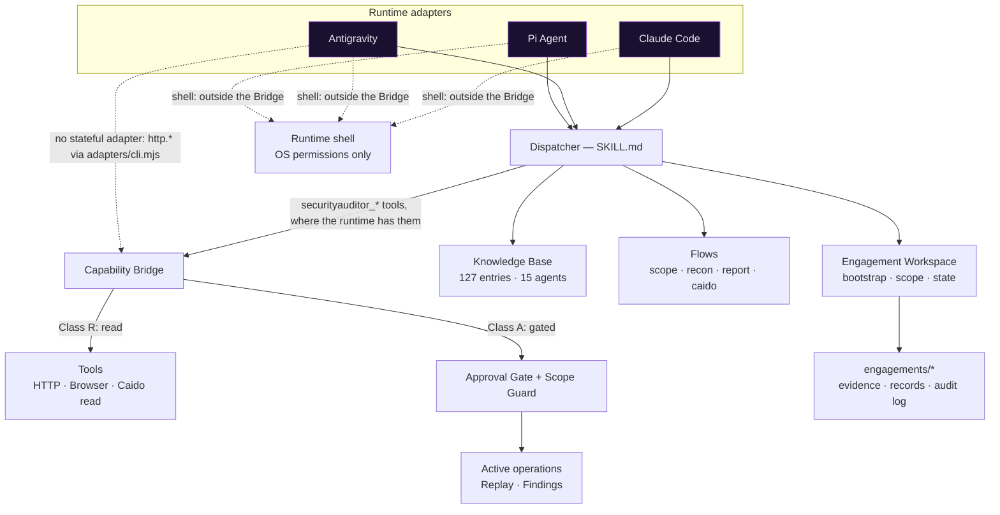
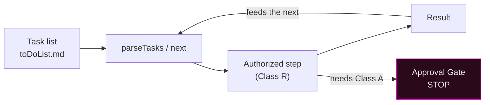
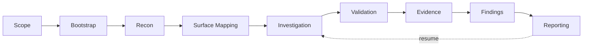

<!--
  SYNAPSE — README (en)
  Formerly "SecurityAuditor / HackBot". The legacy name is preserved in the historical architecture
  reports (docs/architecture-review/) and in stable technical identifiers
  (skill name `security-auditor`, `SA_*` variables, `.hackbot/` state directory) for compatibility.

  Status legend (the project's honest vocabulary):
  IMPLEMENTED = exists in code · TESTED OFFLINE = deterministic test executed ·
  VALIDATED REAL = proven on a real runtime/instance · PARTIAL = only part of the dimension is proven ·
  BLOCKED = stopped by a missing requirement or a refusal · NOT RUN = not executed in this phase ·
  PLANNED = on the roadmap, not implemented.
-->

<p align="center">
  
</p>

<h1 align="center">SYNAPSE</h1>
<p align="center"><strong>Agentic Offensive Security Harness</strong></p>
<p align="center"><em>Connect Intelligence. Orchestrate Security.</em></p>

<p align="center">
  
  
  
  
  
</p>

<p align="center">
  <a href="#overview">Overview</a> ·
  <a href="#core-concepts">Concepts</a> ·
  <a href="#capabilities">Capabilities</a> ·
  <a href="#architecture">Architecture</a> ·
  <a href="#installation">Installation</a> ·
  <a href="#quick-start">Quick Start</a> ·
  <a href="#operating-modes">Modes</a> ·
  <a href="#caido-integration">Caido</a> ·
  <a href="#testing-and-validation">Testing</a> ·
  <a href="#troubleshooting">Troubleshooting</a> ·
  <a href="#documentation">Docs</a> ·
  <a href="#roadmap">Roadmap</a>
</p>

> **SYNAPSE is a runtime-agnostic harness.** It equips an AI agent with a curated offensive knowledge
> base, a strict phased-approval authorization model, a deterministic capability layer and a persistent
> engagement workspace, so that the agent and its human operator conduct a real assessment together,
> under supervision. The priority runtimes are **Pi Agent** and **Google Antigravity**; Claude Code is
> supported as an additional runtime. Validation differs per runtime: see the
> [compatibility matrix](#runtime-compatibility-matrix).

<p align="center"></p>

## Overview


SYNAPSE turns a generic AI agent into a disciplined penetration-testing operator. Where a scanner runs
fixed signatures, SYNAPSE gives the agent **judgment with guardrails**: it routes a request to the right
technique in a 127-entry base, enforces an authorization gate before any active operation, keeps every
artifact inside an isolated engagement and records provenance for each finding.

**Why it exists.** Autonomous offensive tools are dangerous when they act without scope, approval or
auditability. The SYNAPSE thesis is **supervised autonomy**: the agent may read, analyze, plan and chain
authorized steps on its own, but every state-changing or outward-facing action stops at an explicit gate.
The operator stays in control; the agent removes the grunt work.

**Harness vs. scanner.**

| | Scanner | SYNAPSE |
|---|---|---|
| Logic | Fixed signatures | Agent reasoning over a curated KB |
| Scope | Target list | Engagement + Scope Guard, per-project isolation |
| Actions | Fire and forget | Phased approval; gated active operations |
| Output | Raw findings | Findings with provenance + Investigation Records |
| Runtime | Standalone binary | Portable across AI runtimes |

**Roles.** The **operator** authorizes the scope, approves active operations and owns the verdict. The
**agent** discovers surface, analyzes traffic, proposes and chains authorized steps and drafts evidence,
always honest about what is IMPLEMENTED, TESTED OFFLINE, VALIDATED REAL or NOT RUN.

<p align="center"></p>

## Core Concepts


| Concept | What it is |
|---|---|
| **Engagement** | An isolated assessment workspace: nine numbered buckets, `scope.md`, state (`.hackbot/`), evidence, audit log. Several engagements coexist; one is active per session. |
| **Scope** | `scope.md` declares the in-scope hosts. The **Scope Guard** validates every active target against it (Rule 0). A host's presence in captured traffic is **never** authorization to act. |
| **Workspace** | `tools/workspace/engagement.mjs`: bootstrap, selection, confinement (symlink-safe), task parsing, resume. Every write is confined inside the active engagement. |
| **Dispatcher** | The Markdown skill (`SKILL.md`) that routes keywords/flows to KB entries, agents and tools. The single entry point; exactly one exists. |
| **Flows** | `workflows/flows-*.md`: scope, recon, report, intake, proxy, agents, status. Caido investigation: `references/flows-caido-investigation.md`. |
| **Agents** | 15 KB categories in `agents/` (host-inventory, web-testing, code-review, forge, …). |
| **Skills** | Entry skills exposed by the runtime (e.g. `/iniciar-pentest`, `/investigar`, `/modo`). Discovered locally per runtime, never installed globally. |
| **KB** | 112 techniques (T) + 15 forge blueprints (B) = **127** entries, each with real payloads, tier and escalation fields. |
| **Capabilities** | The only way to touch the outside world, through the **Capability Bridge**. Class R (read) vs. Class A (active, gated). |
| **Execution Context** | `{investigationId, scope, allowedCapabilities}` opened per investigation; the Bridge honors nothing outside it. |
| **Copilot** | **Deterministic, zero-LLM**, read-only analysis of captured traffic. The same name designates the session's default **mode** (`/modo`). |
| **Autopilot** | Supervised loop that chains authorized steps from the engagement's task list; stops at every gate. |
| **Caido** | Read-only analysis of HTTP History + supervised, gated active operations (Replay/Findings). |
| **Evidence / Investigation Records** | Capture with preserved provenance; a Record is only written with a grounded hypothesis against an authorized target. |

<p align="center"></p>

## Capabilities


Status is reported honestly according to the project's readiness matrix
([`docs/handbook/operator/readiness.md`](docs/handbook/operator/readiness.md)). VALIDATED REAL below names the
runtime it was proven on; per-runtime detail is in the [compatibility matrix](#runtime-compatibility-matrix).

| Capability | Status | Notes |
|---|---|---|
| Bootstrap / resume / multi-engagement | IMPLEMENTED · TESTED OFFLINE · **VALIDATED REAL** (Claude Code; Pi on synthetic data) | 9 buckets + docs, idempotent, isolated |
| Scope Guard / phased approval | IMPLEMENTED · TESTED OFFLINE · **VALIDATED REAL** (Claude Code); Pi: Bridge out-of-scope refusal only, on synthetic data | Rule 0 enforced even with bulk approval |
| Capability Bridge (Class R / Class A) | IMPLEMENTED · TESTED OFFLINE · `http.inspect` **VALIDATED REAL** (Pi, loopback fixture) | Envelope contract; per-action approval. Approval-gated ops actually executed: **NOT RUN** |
| Recon and surface mapping | IMPLEMENTED · TESTED OFFLINE | `flows-recon`, `flows-scope` |
| Web / API testing KB | IMPLEMENTED · TESTED OFFLINE | `agents/web-testing` (15), `agents/web-inventory` (8) |
| Browser runtime | IMPLEMENTED · TESTED OFFLINE | Playwright-core, real navigation on loopback |
| Caido HTTP History (read-only) | IMPLEMENTED · TESTED OFFLINE · **VALIDATED REAL** (Claude Code) | 21 requests read live; annotated by scope |
| Caido Copilot (deterministic) | IMPLEMENTED · TESTED OFFLINE | zero-LLM endpoint/parameter analysis |
| Supervised active Caido (Replay/Findings) | IMPLEMENTED · TESTED OFFLINE · real **NOT RUN** | Gated; out-of-scope blocked even if approved |
| Autopilot (supervised chaining) | IMPLEMENTED · TESTED OFFLINE · **VALIDATED REAL** (Claude Code; Pi on synthetic data) | 2 autonomous transitions + stop at the gate |
| Copilot (operator-driven execution) | IMPLEMENTED · TESTED OFFLINE · **VALIDATED REAL** (Claude Code; Pi on synthetic data) | read → analyze → persist → present |
| Investigation Records + evidence | IMPLEMENTED · TESTED OFFLINE | provenance preserved |
| Forge micro-tools | IMPLEMENTED · TESTED OFFLINE | 15 blueprints |
| Whitebox intelligence (segregated) | IMPLEMENTED (F1) · rest **PLANNED** | GitHub/Confluence/STRIDE ingestion on the roadmap |
| Reporting pipeline | IMPLEMENTED (templates/libraries) · in-Caido plugin **PLANNED** | `reports/` |

<p align="center"></p>

## Architecture


SYNAPSE is modular and runtime-agnostic. A runtime adapter loads the Markdown dispatcher; the dispatcher
routes to the KB and flows; outward actions go **only** through the Capability Bridge; all state lives in
the engagement workspace. Pi has a native Bridge adapter; Antigravity's only path to the Bridge is the
stateless CLI adapter, so flows such as `/investigar` are **not** protected by the Bridge there (see the
[compatibility matrix](#runtime-compatibility-matrix)).



**Key invariants.** One dispatcher. The Bridge is the only outward surface **of the harness's own tools**.
Modes grant **no** capability; they only describe posture. The Scope Guard validates every active target;
project isolation (`_caidoAssoc`) binds reads to the associated project. Reading captured data never
authorizes acting on it.

> **The Bridge binds its own tools, not the agent.** A runtime's generic shell is outside it: Pi's `bash`, for
> instance, is not sandboxed and can edit the contexts file or reach hosts directly. Real containment needs
> OS-level isolation. See [Limitations](#limitations).

<p align="center"></p>

## Installation

> SYNAPSE is a **central harness with local per-project activation**: skills are **never** installed
> globally. Each runtime discovers the harness in its own way. Requirements: **Node.js ≥ 22** (native test
> runner, `fetch`, native `.env` parsing), `git`. Optional: a Caido desktop instance, a Playwright-core
> browser (auto-detected).

```bash
git clone <your-private-repo> SYNAPSE && cd SYNAPSE
cd tools/web-runtime && npm install && cd -   # runtime deps (reproducible; not versioned)
cp .env.example .env                            # fill in SA_ENGAGEMENT_ROOT, and CAIDO_BASE_URL / CAIDO_TOKEN as needed
node tools/preflight/cli.mjs doctor             # checks the environment and runtime facts
```

This `.env` is central, so it does **not** reach every project. Only known plain config applies everywhere. `CAIDO_TOKEN` loads only for the commands that need it, at
the harness root or in a project activated with `--caido`; `SA_ENGAGEMENT`, `SA_SESSION_ID`, `CAIDO_PROJECT_ID` and other
context-bound keys apply only at the harness root; any unknown key is withheld. Variables already exported win; `SA_SKIP_ENV_FILE=1` skips the file. This reduces
accidental exposure and is not a barrier: an agent with a shell can read the file
([configuration guide](docs/handbook/operator/configuration.md)).

Activation links the harness into a project directory and declares runtimes. `--runtime` takes
`claude-code`, `pi`, `antigravity`, `all` or a comma list (`pi,antigravity`). Without the flag, a first
activation declares `claude-code` and a re-activation keeps the runtimes in the marker. Unknown values are
rejected. Re-activating with another set adds or removes the `.pi/` and `.agents/` links accordingly.

### Pi Agent (primary runtime)

```bash
# Link the harness into a project (nothing is registered globally):
node <harness>/tools/activation/cli.mjs activate --project <dir> --runtime pi
cd <dir>
# A project you reviewed: trust it for this run; skills run as /skill:<name>:
pi -a --provider openai-codex --model gpt-6-luna --thinking low
# A client repository or anything unreviewed: ignore what is local, load only SYNAPSE:
pi -na --skill <harness>/SKILL.md --skill <harness>/.claude/skills \
  -e <harness>/tools/web-runtime/adapters/pi/extension-pi.mjs --provider openai-codex --model gpt-6-luna --thinking low
# Either way, the Capability Bridge tools need an operator-written Execution Context:
SECAUDIT_BRIDGE_CONTEXTS=<ctx.json> pi -a
```

- **Trust:** `-a` and `/trust` load every project-local resource, and a project's `.pi/extensions` is **code that runs on
  startup** (proved by `tools/web-runtime/test-pi-trust.mjs` against real Pi). `activate` and `status` list what the project
  supplies beyond SYNAPSE's links. Context files such as `AGENTS.md` load even with `-na`.
  The project's `.pi/settings.json` is trust-gated; non-interactive modes skip it without `-a`.
- **Model:** Pi's default model may not be OpenAI, so pass provider and model explicitly. Authenticate through
  Pi itself (`/login`); SYNAPSE stores no model credentials.
- **Context files:** activation links `AGENTS.md` (a thin pointer to `SKILL.md`). `bootstrap` also generates
  `AGENTS.md` **at the engagement root** when the project declares `pi` or `antigravity`.
- **From the harness root:** `pi --skill SKILL.md -e tools/web-runtime/adapters/pi/extension-pi.mjs` also works,
  without activation.
- **Avoid:** `pi install <path>` registers globally in `settings.json`: not the recommended path and **not
  exercised**.
- **Degradation:** without parallel dispatch, the agent brief runs as a sequential phase
  (`workflows/flows-agents.md`).
- **Knowledge is not copied:** the adapter points at `skills/`.
- **Status:** **VALIDATED REAL on synthetic data, with unstable task completion** (Linux, non-interactive `--mode json`). Interactive TUI,
  `/trust`, real targets, Caido and Windows: **NOT RUN**. Guide:
  [`docs/handbook/operator/pi-agent.md`](docs/handbook/operator/pi-agent.md).

### Google Antigravity (primary runtime)

```bash
# Link the harness into a project (nothing is registered globally):
node <harness>/tools/activation/cli.mjs activate --project <dir> --runtime antigravity
cd <dir>
agy models           # lists the model ids available to your account
agy -p /skills       # lists skills without a model turn; the dispatcher and the 13 SYNAPSE skills must appear
```

- **CLI:** `agy` is a headless agentic CLI: `agy -p "<prompt>" --model <id> --output-format json|stream-json --print-timeout 120s`,
  with `--continue` and `--conversation <id>` to resume. Plain `agy` is interactive.
- **Discovery:** activation links `AGENTS.md` and `.agents/skills`: links to the 13 skills and to `SKILL.md` as
  `security-auditor`, one dispatcher and no copy. Start a prompt with `/security-auditor` to load it; a `read_file` event in
  `stream-json` is the evidence, not a plausible answer.
- **Headless block:** anything that needs a shell command is refused on an account without `--mode auto`. The
  decision on how to proceed is the operator's: see the
  [Antigravity guide](docs/handbook/operator/antigravity.md).
- **Bridge:** there is no stateful adapter and **flows here are not protected by the Bridge**: without
  `securityauditor_*` tools, Scope Guard and Approval Gate do not apply. `tools/web-runtime/adapters/cli.mjs` is the only path
  (`capabilities.*`, `http.*` GET/HEAD). With `SECAUDIT_BRIDGE_CONTEXTS` it uses that file's context, bound to the
  engagement selected in the project; either form reports `operatorVerified: false`, because the caller may be the agent
  itself. `/investigar`'s stateful ops have no path here.
- **Knowledge is not copied:** it points at `skills/`.
- **Status:** **PARTIAL, not homologated.** Skill discovery, `AGENTS.md` loading and opening the dispatcher are VALIDATED REAL;
  following the dispatcher is not verified, and workflow scenarios are BLOCKED headless.

### Claude Code (additional runtime)

```bash
# .claude/skills/<name>/ are real directories, discovered at SESSION START
node tools/activation/cli.mjs activate --project <dir>   # local activation in an external project, if needed
# then open a new session; skills such as /iniciar-pentest, /investigar, /modo appear
```

- **Status:** **VALIDATED REAL** (S4 acceptance on Omarchy/Linux): bootstrap, Copilot, supervised Autopilot and
  read-only Caido integration exercised live. Not re-run live in the latest round; activation and offline tests
  still pass.

> **Honesty gate:** SYNAPSE is designed to be runtime-agnostic, and Pi/Antigravity are the intended primary
> runtimes, but a dimension is only marked **VALIDATED REAL** on a runtime after a real run on it. See
> [`docs/handbook/operator/runtimes.md`](docs/handbook/operator/runtimes.md).

<p align="center"></p>

## Configuration

| Variable | Required | Purpose |
|---|---|---|
| `CAIDO_BASE_URL` | for Caido | Caido GraphQL base URL |
| `CAIDO_TOKEN` | for Caido | Bearer token (**never printed / versioned**). From `.env` only at the harness root or with `activate --caido`, and only for the commands that need it |
| `SA_ENGAGEMENT_ROOT` | yes, for engagements | Engagements root directory (absolute path, outside the harness; inside it, only `engagements/` is accepted) |
| `SA_SESSION_ID` | optional | Separate session for the active-engagement pointer. An activated project or the harness root derives a stable session without it; an explicit value stays bound to the project. Outside both it is the only way to have a selection: otherwise `use` refuses |
| `SECAUDIT_BRIDGE_CONTEXTS` | for Bridge tools on Pi | Path to the operator-written Execution Context JSON |
| `SA_SKIP_ENV_FILE=1` | tests | Hermetic test mode (ignores `.env`) |

> The `SA_*` prefix and the `.hackbot/` state directory are **stable legacy identifiers**, kept for
> compatibility; the product name is SYNAPSE, but these technical contracts intentionally stay unchanged.
> Secrets live only in `.env` (git-ignored) and in the per-engagement `.config`, never in Git.
> Run `node tools/preflight/cli.mjs doctor` to check the configuration without exposing values.

<p align="center"></p>

## Quick Start

The common operating flow (runtime-neutral):

1. **Prepare SYNAPSE**: `npm install` in `tools/web-runtime`, configure `.env`, run `doctor`.
2. **Select a runtime**: Pi Agent, Antigravity or Claude Code, and activate a project for it.
3. **Create an engagement**: isolated workspace with buckets + `scope.md`.
4. **Define the scope**: list the authorized hosts in `scope.md`.
5. **Select the engagement**: it becomes the session's active one.
6. **Choose a mode**: Copilot (default) or supervised Autopilot.
7. **Start the pentest**: recon and surface mapping within scope.
8. **Investigate**: analyze traffic/surface; draft grounded Investigation Records.
9. **Review the results**: findings, evidence, provenance.
10. **Resume**: come back later; state and tasks persist idempotently.

The engagement steps are plain CLIs, identical in any activated project and runnable by the operator or the agent:

```bash
node tools/workspace/cli.mjs init --name lab --modality blackbox
node tools/workspace/cli.mjs scope --name lab --file <scope.md>   # needs '# Scope' and '## In Scope'
node tools/workspace/cli.mjs use --name lab
node tools/workspace/cli.mjs bootstrap                            # AGENTS.md or CLAUDE.md, per the activation marker
node tools/modes/cli.mjs status
node tools/preflight/cli.mjs preflight --profile core-lab
```

**Pi Agent** (from the activated project):

```bash
# Interactive; then /skill:criar-engagement → /skill:usar-engagement → /skill:iniciar-pentest → /skill:investigar → /skill:modo
pi -a --provider openai-codex --model gpt-6-luna --thinking low

# Non-interactive, then resume the same session:
pi -a --mode json --provider openai-codex --model gpt-6-luna --thinking low --session-dir <dir> -- "/skill:engagement-atual"
pi -a --mode json --provider openai-codex --model gpt-6-luna --thinking low --session-dir <dir> --continue -- "What is the next task?"
```

**Antigravity** (from the activated project):

```bash
# Interactive: a human approves each prompt (this path is NOT RUN by the project):
agy

# Headless: skill expansion and file reads work; anything needing a shell command, skill CLIs included, is denied
# unless the operator decides otherwise:
agy -p "<prompt>" --model <id> --output-format json --print-timeout 120s
```

**Claude Code** (slash skills, discovered per session):

```text
/criar-engagement   →   /usar-engagement   →   /iniciar-pentest   →   /investigar   →   /modo
```

> A skill name is the same on every runtime; the invocation differs: `/skill:<name>` on Pi, `/<name>` on
> Antigravity and Claude Code. See the compatibility matrix for what is proven on each.

<p align="center"></p>

## Operating Modes




- **Copilot (default).** The operator drives; the agent runs allowed steps (Class R) on request: read,
  analyze, persist, present.
- **Autopilot (supervised).** The agent chains authorized steps from the task list, feeding each result into
  the next, and **stops at every Approval Gate** (any Class A / active operation).
- **Modes grant no capability.** They only define posture; permission always comes from Bridge + Scope Guard +
  Approval Gate. Autopilot never runs an active operation without explicit approval.
- **Persistence / stop criteria.** Progress is idempotent and resumable; the loop stops at a gate, an exhausted
  budget, a missing capability (→ NOT RUN) or an empty task list. Switching engagement returns the mode to
  Copilot.

<p align="center"></p>

## Commands and Skills

| Layer | What | Where |
|---|---|---|
| Harness skills | Dispatcher + KB routing | `SKILL.md`, `agents/`, `workflows/flows-*.md` |
| Runtime skills | Entry points exposed by the runtime | Claude Code: `.claude/skills/` · Pi: `.pi/settings.json` (`/skill:<name>`) · Antigravity: `AGENTS.md` + `.agents/skills` |
| Internal CLI | Deterministic tools | `tools/workspace/cli.mjs`, `tools/modes/cli.mjs`, `tools/preflight/cli.mjs`, `tools/activation/cli.mjs` |
| Capability Bridge | Outward actions | `tools/web-runtime/bridge.mjs` |
| Specialized agents | KB categories | `agents/<category>/` |

Equivalence is provided **only where there is real support**: the matrix below never invents it.

### Runtime compatibility matrix

Pi figures are from Pi 1.4.0 with `openai-codex/gpt-6-luna --thinking low`, on **synthetic data**, Linux,
non-interactive `--mode json`. Antigravity figures are from antigravity-cli 1.5.1 with `gemini-3.8-flash-low`,
headless.

| Dimension | Pi Agent | Antigravity | Claude Code |
|---|---|---|---|
| Entry point | `pi -a` from a reviewed activated project, or `pi -na` with explicit paths; `/skill:<name>` | `agy` from an activated project; `/<name>` | `.claude/skills/` (session start) |
| Skill discovery | **VALIDATED REAL** | **VALIDATED REAL** (13/13) | **VALIDATED REAL** |
| Local activation | **VALIDATED REAL** | **VALIDATED REAL** | **VALIDATED REAL** |
| Dispatcher | **VALIDATED REAL** (read by the agent) | **VALIDATED REAL** for opening it: `read_file` in the log and a random marker from the file (scenario 2); following it is not verified | **VALIDATED REAL** |
| Workspace / Bootstrap | **VALIDATED REAL** | **BLOCKED** headless; interactive NOT RUN | **VALIDATED REAL** |
| Mode switch | **VALIDATED REAL** | **BLOCKED** headless; interactive NOT RUN | **VALIDATED REAL** |
| Capabilities (Bridge) | **VALIDATED REAL**: `http.inspect` on a loopback fixture, out-of-scope refused | **PARTIAL**: no stateful adapter, so flows are not Bridge-protected; `adapters/cli.mjs` TESTED OFFLINE, stateless only; through the agent BLOCKED | TESTED OFFLINE |
| Approval-gated ops actually executed | **NOT RUN** | **NOT RUN** | **NOT RUN** |
| Caido (read-only) | TESTED OFFLINE; live NOT RUN | **NOT RUN** | **VALIDATED REAL** |
| Copilot / Autopilot | **VALIDATED REAL**: task with a disk effect; chain over 2 safe tasks stopping at the Class A gate | **BLOCKED** headless; interactive NOT RUN | **VALIDATED REAL** on a synthetic lab; on real in-scope traffic: NOT RUN (NO DATA) |
| Persistence / resume | **VALIDATED REAL** (`--continue`) | **BLOCKED**: conversation resumes, state read denied | **VALIDATED REAL** |
| Controlled failure | **VALIDATED REAL** | **PARTIAL**: read-failure path only | TESTED OFFLINE |
| Project isolation | **VALIDATED REAL** | **PARTIAL**: verified through the CLI only; the agent's shell was denied | TESTED OFFLINE |
| Interactive use | **NOT RUN** (TUI, `/trust`) | **NOT RUN** | **VALIDATED REAL** |
| Live end-to-end, real target | **NOT RUN** | **NOT RUN** | **PARTIAL**: integration VALIDATED REAL; in-scope analysis NOT RUN (NO DATA) |
| Windows | **NOT RUN** | **NOT RUN** | **NOT RUN** |

> **Pi:** the last full acceptance pass on the final tree scored **12/14** (10 runs, about US$0.05): in scenarios 4 and 12 the
> agent stopped before finishing, without breaching any limit. Earlier passes this round scored 14/14 and 13/14, so **results
> vary between passes**: across 6 measurements scenario 4 passed 4 and scenario 12 passed 3, and none sent a request, invented
> an engagement or changed the selection. See [report 48](docs/architecture-review/48-runtime-security-hardening.md).
> The Autopilot prompt names the `next` selector; an
> earlier run without that hint called `next` once. This is validation on synthetic data,
> not a pentest of a real target.
>
> **Antigravity:** scenario 1 PASS (activation, discovery); scenario 2 **PASS** (the agent opens the dispatcher, shown by a `read_file`
> event and a random marker from the file; following it is not verified); scenarios 3-11 **BLOCKED** headless, never run past the
> permission denial; scenario 12 PASS covers only a read-failure path; scenario 13 **PARTIAL**. Antigravity is
> **not homologated**.
>
> **Claude Code:** validated in S4 (integration and experience); the analysis → leads → Investigation Record chain
> on real in-scope traffic remains NOT RUN (NO DATA).
>
> **Codex** is not part of this distribution (scope decision). `openai-codex` above is the name of a Pi model
> provider, not a runtime integration.

<p align="center"></p>

## Pentest Flows



- **Blackbox / Graybox / Whitebox** are supported modalities. Whitebox intelligence is **segregated** and
  partially implemented (F1); deeper ingestion (GitHub/Confluence/STRIDE) is on the roadmap and is **not**
  presented as complete.
- Every active step goes through the Scope Guard and the Approval Gate. Evidence preserves provenance; an
  Investigation Record is only written with a grounded hypothesis against an authorized target.

<p align="center"></p>

## Caido Integration


SYNAPSE talks to Caido over GraphQL (`<baseUrl>/graphql`, `Authorization: Bearer <token>`).

- **Associated project.** All reads are bound to the engagement's associated project (`_caidoAssoc`);
  cross-project access is refused (`caido-project-mismatch`).
- **HTTP History (read-only).** `caido.history` / `caido.request` return **all** captured records of the
  associated project, each **annotated** `inScope` / out-of-scope. Reading already captured data contacts no
  external host, so it is **not** withheld by the Scope Guard. Provenance
  (source / projectId / requestId / responseId / timestamp) is preserved.
- **HTTPQL, pagination, fields** supported; `currentProject` is the source of truth on local instances (the
  `@cloud` `projects` field degrades to empty).
- **Copilot** performs deterministic, zero-LLM endpoint/parameter analysis over the History.
- **Supervised active operations.** `caido.replay.run` and `caido.findings.create` are **Class A**: they validate
  the target against `scope.md` **even with bulk approval** and require per-action approval.
  **Observing a host in the History is never authorization to act against it.**
- **Known limitation.** Importing/generating native Caido workflows is **post-MVP** (the SDL exposes an opaque
  `definition`); it does not block the core.

<p align="center"></p>

## Project Structure

```text
SYNAPSE/
├── SKILL.md                     # Dispatcher (entry point; skill name: security-auditor [legacy])
├── AGENTS.md                    # Thin pointer to SKILL.md for runtimes that load it; grants no permissions
├── README.md
├── manifest-h0.json             # KB manifest (127 entries)
├── .env.example  .config.example
├── .gitignore
├── adapters/                    # Runtime adapter docs: pi-agent · antigravity · claude-code
├── agents/                      # Knowledge base: 15 categories (112 techniques)
├── workflows/  references/      # Flows (scope/recon/report/…) + templates, doctrine and Caido investigation flow
├── policies/                    # authorization-gate · native-tooling-doctrine · verification-contract
├── skills/                      # KB bodies (T techniques + B blueprints = 127)
├── reports/                     # Report templates and libraries
├── intake/                      # KB intake queue
├── images/                      # Banner and README assets
├── tools/
│   ├── workspace/               # engagement.mjs, bootstrap, cli, autopilot
│   ├── web-runtime/             # bridge.mjs, backends/caido.mjs + caido-active.mjs, caido-copilot, adapters/pi
│   ├── modes/                   # copilot / autopilot posture
│   ├── preflight/               # doctor, env-loader
│   ├── activation/              # local per-project activation
│   └── acceptance/              # real-runtime acceptance (separate from the suites; costs money)
├── .claude/                     # Claude Code skills (real dirs) + hooks + settings
├── .pi/                         # Pi project settings (skills + Bridge extension; trust-gated)
├── .agents/                     # Antigravity skills (link to .claude/skills)
├── docs/
│   ├── handbook/                # Operator + engineering handbook
│   └── architecture-review/     # Historical reviews 00–48 and archive/ (traceability)
└── engagements/                 # Local engagement data (git-ignored)
```

<p align="center"></p>

## Testing and Validation

Two separate tracks, whose metrics are **never mixed**.

**Offline (35 suites + KB validator).** All suites use Node's native test runner (no external test deps), make no
model call and are hermetic with `SA_SKIP_ENV_FILE=1`.

```bash
# KB validator: must report T=112/112, B=15/15, total=127/127
node docs/architecture-review/validate_h0.mjs . docs/architecture-review/baseline/manifest.json

# Representative suites
node tools/workspace/test-engagement.mjs        # workspace
node tools/workspace/test-bootstrap.mjs         # bootstrap (18)
node tools/workspace/test-multi-engagement.mjs  # multi-engagement (31)
node tools/workspace/test-skills.mjs            # skills contract (62)
node tools/workspace/test-autopilot.mjs         # autopilot loop (13)
node tools/workspace/test-runtime-contract.mjs  # sessions, roots, bootstrap by runtime (59)
node tools/modes/test-modes.mjs                 # modes (18)
node tools/web-runtime/test-bridge.mjs          # capability bridge
node tools/web-runtime/test-caido.mjs           # caido read + scope (21)
node tools/web-runtime/test-caido-copilot.mjs   # deterministic copilot (24)
node tools/activation/test-activation.mjs       # activation (18)
node tools/activation/test-runtime-links.mjs    # per-runtime link sets (44)
node tools/preflight/test-preflight.mjs         # preflight / doctor
```

> The `test-pi-adapter` / `test-pi-entry` / `test-pi-rpc` tests are **integration tests with real Pi** (they require
> `PI_PKG_DIR` / `PI_BINARY`); without those variables they are **BLOCKED / NOT RUN**, which is not a regression
> (`test-pi-entry` and `test-pi-rpc` exit 1 with an error naming the missing variable).

**Real-runtime acceptance (separate, costs money).** It spends model budget, so it refuses to start without
`--accept-model-cost`, and `--harness` must be an export without `.env` or `engagements/`. A verdict comes from tool
calls in the JSON log and effects on disk, never from model prose alone.

```bash
node tools/acceptance/runtime-acceptance.mjs --runtime pi|antigravity --harness <export> --out <dir> --accept-model-cost
```

<p align="center"></p>

## Troubleshooting

| Symptom | Cause | Action |
|---|---|---|
| Pi does not see SYNAPSE skills or Bridge tools | Project `.pi/settings.json` is trust-gated | On a reviewed project, `pi -a` or `/trust`; otherwise `pi -na` with explicit paths |
| `no unambiguous project context` | Not at an activated project or the harness root (a harness subdirectory or a nested repository doesn't count), or the marker is unreadable | Run from the root, activate the project, or set `SA_SESSION_ID` for automation; read commands also take `--name` |
| `CAIDO_TOKEN withheld` | This project did not opt in to the central token | The operator runs `activate --project <dir> --caido`, or exports it for that command |
| Pi uses an unexpected model | Pi's default model may not be OpenAI | Pass `--provider` and `--model` |
| Pi lists skills that are not SYNAPSE's | Pi's real `HOME` loads your own global skills too | Expected; SYNAPSE adds to them and changes nothing global |
| Bridge tools refuse with `no-trusted-context` | `SECAUDIT_BRIDGE_CONTEXTS` missing or invalid | Point it at the operator-written JSON |
| `agy` exits 0 with `status: SUCCESS` and an empty response | A tool was auto-denied headless | Inspect `denied_actions`; see the [Antigravity guide](docs/handbook/operator/antigravity.md) |
| `agy -p /skills` shows no SYNAPSE skills | Project not activated for Antigravity | `activate --project <dir> --runtime antigravity` |
| `no active engagement` in a project | Selection is per activated project | `node tools/workspace/cli.mjs use --name <n>` in that project |
| `root-inside-harness` | `SA_ENGAGEMENT_ROOT` resolves inside the harness | Use a directory outside it, or the harness's `engagements/` |
| `unknown runtime` / `bad-runtime` | Value not supported by the command | Use the values listed in the error |
| Mode went back to Copilot | Switching engagement resets the mode | Select the mode again |

Full table: [`docs/handbook/operator/troubleshooting.md`](docs/handbook/operator/troubleshooting.md).

<p align="center"></p>

## Documentation

| Area | Path |
|---|---|
| Start / Operator Handbook | [`docs/handbook/`](docs/handbook/) |
| Pi Agent guide | [`docs/handbook/operator/pi-agent.md`](docs/handbook/operator/pi-agent.md) |
| Antigravity guide | [`docs/handbook/operator/antigravity.md`](docs/handbook/operator/antigravity.md) |
| Runtimes (Pi / Antigravity / Claude) | [`docs/handbook/operator/runtimes.md`](docs/handbook/operator/runtimes.md) · [`adapters/`](adapters/) |
| Readiness / MVP matrix | [`docs/handbook/operator/readiness.md`](docs/handbook/operator/readiness.md) |
| Documentation index (current vs. historical) | [`docs/README.md`](docs/README.md) |
| Caido live history monitor | [`docs/handbook/10-caido-live-history-monitor.md`](docs/handbook/10-caido-live-history-monitor.md) |
| Capability roadmap | [`docs/architecture-review/08-capability-roadmap.md`](docs/architecture-review/08-capability-roadmap.md) |
| Historical reviews (00–47) | [`docs/architecture-review/`](docs/architecture-review/) |

The handbook and operator guides are written in Portuguese.

<p align="center"></p>

## Roadmap

| State | Items |
|---|---|
| **Validated real** | Bootstrap/resume, Scope Guard, Copilot, supervised Autopilot, read-only Caido (Claude Code / Omarchy); activation through Autopilot gate, resume and Bridge `http.inspect` (Pi, synthetic data); skill discovery, `AGENTS.md` loading and opening the dispatcher (Antigravity) |
| **Tested offline** | Capability Bridge, active Caido (Replay/Findings), monitor, investigation records, forge, Pi adapter, engagement isolation, credential scope, CLI adapter trust boundary |
| **Planned** | Whitebox ingestion (GitHub/Confluence/STRIDE), in-Caido evidence/reporting plugin, credential-store/live probe |
| **Post-MVP / V2** | Importing/generating native Caido workflows (kept out of the mandatory MVP) |
| **Validation pending** | Analysis on real in-scope traffic (data-gated, no product defect); Pi on real targets, interactive and with Caido; Antigravity past the permission block, following the dispatcher and a stateful Bridge path; approval-gated ops actually executed; Windows |

<p align="center"></p>

## Limitations

- **Pi's validation is on synthetic data**, Linux, non-interactive. Interactive TUI, the `/trust` flow, real targets,
  Caido, Windows and approval-gated ops actually executed are **NOT RUN**.
- **Antigravity is partial and not homologated.** Skills, `AGENTS.md` and opening the dispatcher are verified, but the
  agent following it is not, and headless shell commands are denied. A denied run still exits 0 with `status: SUCCESS` and an
  empty response, so wrappers must inspect `denied_actions`. There is no stateful Bridge adapter, so `/investigar` is not
  Bridge-protected there. Do not read "primary runtime" as "validated".
- **The Bridge binds its own tools, not the agent.** Pi's `bash` is not sandboxed: it can read the central `.env`, edit the
  contexts file or reach hosts directly. Containment needs OS-level isolation; SYNAPSE ships no sandbox.
- **Isolation is by context, not by client data.** A selection cannot cross projects, but `list` and `--name` still see every
  engagement under one `SA_ENGAGEMENT_ROOT`, and an exported `SA_ENGAGEMENT` applies everywhere. Use one root per client.
- **Pi's real `HOME`** also loads the user's own global skills alongside SYNAPSE.
- **Analysis on real in-scope traffic** is pending an in-scope capture by the operator (data-gated).
- **Active Caido operations** require a real authorized instance and per-action approval.
- **Native Caido workflow generation** is post-MVP.
- SYNAPSE assists **authorized** security testing **only**. It never treats observed traffic as authorization, and it
  refuses destructive use, DoS, mass-targeting or detection evasion.

<p align="center"></p>

## Development

- **Add a technique/blueprint:** follow `references/template-technique.md`; keep the KB at 127 (or update
  `manifest-h0.json` + baseline and run the validator again).
- **Add a flow:** `workflows/flows-*.md`, wired through the dispatcher.
- **Add a capability:** extend the Bridge (`BRIDGE_OPS`), classify Class R vs. Class A, add the gate and a
  deterministic test. Never bypass the Scope Guard or the Approval Gate.
- **Conventions:** one dispatcher; the Bridge is the only outward surface; modes grant no capability; every claim is
  labeled by its evidence state. Run the full suite + validator before any commit.

---

<p align="center">
  
  &nbsp;<strong>SYNAPSE</strong> — Connect Intelligence. Orchestrate Security.
</p>
<p align="center"><sub>Formerly SecurityAuditor / HackBot · runtime-agnostic · supervised autonomy · authorized testing only</sub></p>
