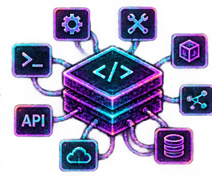
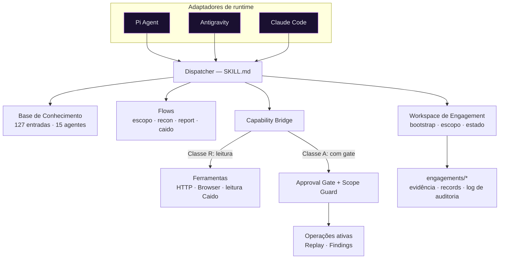
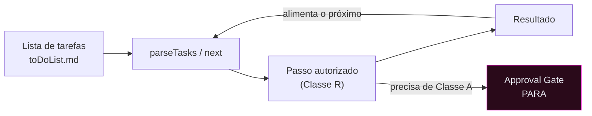
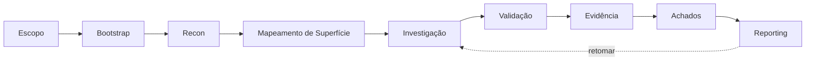

<!--
  SYNAPSE — README (pt-BR)
  Antigo "SecurityAuditor / HackBot". O nome legado é preservado nos relatórios históricos de
  arquitetura (docs/architecture-review/) e em identificadores técnicos estáveis
  (nome da skill `security-auditor`, variáveis `SA_*`, diretório de estado `.hackbot/`) por compatibilidade.

  Legenda de status (vocabulário honesto do projeto, mantido em inglês por consistência com os docs):
  IMPLEMENTED = existe em código · TESTED OFFLINE = teste determinístico executado ·
  VALIDATED REAL = comprovado em runtime/instância real · NOT RUN = não executado nesta fase ·
  PLANNED = no roadmap, não implementado.
-->

<p align="center">
  
</p>

<h1 align="center">SYNAPSE</h1>
<p align="center"><strong>Harness Agêntico de Segurança Ofensiva</strong></p>
<p align="center"><em>Connect Intelligence. Orchestrate Security.</em></p>

<p align="center">
  
  
  
  
  
</p>

<p align="center">
  <a href="#visão-geral">Visão Geral</a> ·
  <a href="#conceitos-centrais">Conceitos</a> ·
  <a href="#capacidades">Capacidades</a> ·
  <a href="#arquitetura">Arquitetura</a> ·
  <a href="#instalação">Instalação</a> ·
  <a href="#início-rápido">Início Rápido</a> ·
  <a href="#modos-operacionais">Modos</a> ·
  <a href="#integração-caido">Caido</a> ·
  <a href="#testes-e-validação">Testes</a> ·
  <a href="#documentação">Docs</a> ·
  <a href="#roadmap">Roadmap</a>
</p>

> **O SYNAPSE é um harness agnóstico de runtime.** Ele equipa um agente de IA com uma
> base de conhecimento ofensivo curada, um modelo estrito de autorização por aprovação faseada, uma
> camada de capacidades determinística e um workspace de engagement persistente — de modo que o agente
> e seu operador humano conduzam um assessment real juntos, sob supervisão. Os runtimes prioritários são
> **Pi Agent** e **Google Antigravity**; o Claude Code é suportado como runtime adicional.

<p align="center"></p>

## Visão Geral


O SYNAPSE transforma um agente de IA genérico em um operador disciplinado de teste de intrusão. Onde um
scanner roda assinaturas fixas, o SYNAPSE dá ao agente **discernimento com guardrails**: roteia uma
solicitação para a técnica certa numa base de 127 entradas, impõe um gate de autorização antes de qualquer
operação ativa, mantém todo artefato dentro de um engagement isolado e registra proveniência para cada achado.

**Por que existe.** Ferramentas ofensivas autônomas são perigosas quando agem sem escopo, aprovação ou
auditabilidade. A tese do SYNAPSE é **autonomia supervisionada**: o agente pode ler, analisar, planejar e
encadear passos autorizados por conta própria, mas toda ação que altera estado ou é voltada para fora para
num gate explícito. O operador mantém o controle; o agente elimina o trabalho braçal.

**Harness vs. scanner.**

| | Scanner | SYNAPSE |
|---|---|---|
| Lógica | Assinaturas fixas | Raciocínio do agente sobre uma KB curada |
| Escopo | Lista de alvos | Engagement + Scope Guard, isolamento por projeto |
| Ações | Dispara e esquece | Aprovação faseada; operações ativas com gate |
| Saída | Achados crus | Achados com proveniência + Investigation Records |
| Runtime | Binário standalone | Portável entre runtimes de IA |

**Papéis.** O **operador** autoriza o escopo, aprova operações ativas e é dono do veredito. O **agente**
descobre superfície, analisa tráfego, propõe e encadeia passos autorizados e redige evidência — sempre
honesto sobre o que está IMPLEMENTED, TESTED OFFLINE, VALIDATED REAL ou NOT RUN.

<p align="center"></p>

## Conceitos Centrais


| Conceito | O que é |
|---|---|
| **Engagement** | Um workspace de assessment isolado: nove buckets numerados, `scope.md`, estado (`.hackbot/`), evidência, log de auditoria. Vários engagements coexistem; um fica ativo por sessão. |
| **Escopo (Scope)** | O `scope.md` declara os hosts em escopo. O **Scope Guard** valida todo alvo ativo contra ele (Regra 0). A presença de um host no tráfego capturado **nunca** é autorização para agir. |
| **Workspace** | `tools/workspace/engagement.mjs` — bootstrap, seleção, confinamento (seguro a symlink), parsing de tarefas, retomada. Toda escrita confinada dentro do engagement ativo. |
| **Dispatcher** | A skill em Markdown (`SKILL.md`) que roteia palavras-chave/flows para entradas da KB, agentes e ferramentas. O ponto de entrada único; existe exatamente um. |
| **Flows** | `workflows/flows-*.md` — escopo, recon, report, intake, proxy, agentes, status. Investigação Caido: `references/flows-caido-investigation.md`. |
| **Agentes** | 15 categorias de KB em `agents/` (host-inventory, web-testing, code-review, forge, …). |
| **Skills** | Skills de entrada expostas pelo runtime (ex.: `/iniciar-pentest`, `/investigar`, `/modo`). Descobertas localmente por runtime — nunca instaladas globalmente. |
| **KB** | 112 técnicas (T) + 15 blueprints de forge (B) = **127** entradas, cada uma com payloads reais, tier e campos de escalonamento. |
| **Capacidades** | A única forma de tocar o mundo externo, através do **Capability Bridge**. Classe R (leitura) vs. Classe A (ativa, com gate). |
| **Execution Context** | `{investigationId, scope, allowedCapabilities}` aberto por investigação; o Bridge não honra nada fora dele. |
| **Copilot** | Análise read-only **determinística, zero-LLM**, do tráfego capturado. O mesmo nome designa o **modo** padrão da sessão (`/modo`). |
| **Autopilot** | Loop supervisionado que encadeia passos autorizados a partir da lista de tarefas do engagement; para em todo gate. |
| **Caido** | Análise read-only do HTTP History + operações ativas supervisionadas (Replay/Findings), com gate. |
| **Evidência / Investigation Records** | Captura com proveniência preservada; um Record só é escrito com hipótese fundamentada contra um alvo autorizado. |

<p align="center"></p>

## Capacidades


O status é reportado honestamente conforme a matriz de readiness do projeto
([`docs/handbook/operator/readiness.md`](docs/handbook/operator/readiness.md)).

| Capacidade | Status | Notas |
|---|---|---|
| Bootstrap / retomada / multi-engagement | IMPLEMENTED · TESTED OFFLINE · **VALIDATED REAL** | 9 buckets + docs, idempotente, isolado |
| Scope Guard / aprovação faseada | IMPLEMENTED · TESTED OFFLINE · **VALIDATED REAL** | Regra 0 imposta mesmo com aprovação em bloco |
| Capability Bridge (Classe R / Classe A) | IMPLEMENTED · TESTED OFFLINE | Contrato de envelope; aprovação por ação |
| Recon e mapeamento de superfície | IMPLEMENTED · TESTED OFFLINE | `flows-recon`, `flows-scope` |
| KB de teste Web / API | IMPLEMENTED · TESTED OFFLINE | `agents/web-testing` (15), `agents/web-inventory` (8) |
| Runtime de browser | IMPLEMENTED · TESTED OFFLINE | Playwright-core, navegação real em loopback |
| Caido HTTP History (read-only) | IMPLEMENTED · TESTED OFFLINE · **VALIDATED REAL** | 21 requests lidos ao vivo; anotados por escopo |
| Caido Copilot (determinístico) | IMPLEMENTED · TESTED OFFLINE | análise zero-LLM de endpoints/parâmetros |
| Caido ativo supervisionado (Replay/Findings) | IMPLEMENTED · TESTED OFFLINE · real **NOT RUN** | Com gate; out-of-scope bloqueado mesmo se aprovado |
| Autopilot (encadeamento supervisionado) | IMPLEMENTED · TESTED OFFLINE · **VALIDATED REAL** | 2 transições autônomas + parada no gate |
| Copilot (execução conduzida pelo operador) | IMPLEMENTED · TESTED OFFLINE · **VALIDATED REAL** | ler → analisar → persistir → apresentar |
| Investigation Records + evidência | IMPLEMENTED · TESTED OFFLINE | proveniência preservada |
| Micro-ferramentas Forge | IMPLEMENTED · TESTED OFFLINE | 15 blueprints |
| Inteligência Whitebox (segregada) | IMPLEMENTED (F1) · resto **PLANNED** | ingestão GitHub/Confluence/STRIDE no roadmap |
| Pipeline de reporting | IMPLEMENTED (templates/bibliotecas) · plugin in-Caido **PLANNED** | `reports/` |

<p align="center"></p>

## Arquitetura



O SYNAPSE é modular e agnóstico de runtime. Um adaptador de runtime carrega o dispatcher em Markdown; o
dispatcher roteia para a KB e os flows; ações para fora passam **somente** pelo Capability Bridge; todo o
estado vive no workspace de engagement.



**Invariantes-chave.** Um dispatcher. O Bridge é a única superfície para fora. Os modos concedem **nenhuma**
capacidade — apenas descrevem postura. O Scope Guard valida todo alvo ativo; o isolamento de projeto
(`_caidoAssoc`) amarra leituras ao projeto associado. Ler dados capturados nunca autoriza agir sobre eles.

<p align="center"></p>

## Instalação

> O SYNAPSE é um **harness central com ativação local por projeto** — skills **nunca** são instaladas
> globalmente. Cada runtime descobre o harness à sua maneira. Requisitos: **Node.js ≥ 22** (test runner
> nativo, `fetch`, parsing nativo de `.env`), `git`. Opcional: uma instância Caido desktop, um browser
> Playwright-core (auto-detectado).

```bash
git clone <seu-repo-privado> SYNAPSE && cd SYNAPSE
cd tools/web-runtime && npm install && cd -   # deps de runtime (reproduzíveis; não versionadas)
cp .env.example .env                            # preencha CAIDO_BASE_URL / CAIDO_TOKEN conforme necessário
node tools/preflight/cli.mjs doctor             # verifica ambiente e fatos de runtime
```

### Pi Agent (runtime primário)

```bash
# Carga explícita e local do dispatcher (nada é registrado globalmente):
pi --skill SKILL.md
# Ferramentas do Capability Bridge, pela extensão do adaptador:
pi -e tools/web-runtime/adapters/pi/extension-pi.mjs
```

- **Descoberta:** `pi --skill <path>/SKILL.md`, isolado. `pi install <path>` faz registro **global** em
  `settings.json`: não é o caminho recomendado e **não foi exercido**.
- **Arquivos de contexto:** o Pi lê `AGENTS.md` / `CLAUDE.md`, gerados **na raiz do engagement** (não existem na
  raiz deste repositório) pelo Flow 8 ou por `node tools/workspace/cli.mjs bootstrap --runtime agents` (ou `both`).
- **Degradação:** sem dispatch paralelo, o brief do agente roda como fase sequencial
  (`workflows/flows-agents.md`).
- **Conhecimento não é copiado** — o adaptador aponta para `skills/`.
- **Status:** adaptador + contratos RPC/entry **TESTED OFFLINE** (`tools/web-runtime/adapters/pi/`,
  `test-pi-*`). Homologação de pentest live completa: **NOT RUN** — ver a matriz de compatibilidade.

### Google Antigravity (runtime primário)

- **Descoberta:** contrato via `AGENTS.md`, gerado **na raiz do engagement** pelo Flow 8 ou por
  `node tools/workspace/cli.mjs bootstrap --runtime agents`. A ativação local não o cria.
- **Roteamento / policies:** idênticos aos demais runtimes; o brief carrega as policies verbatim.
- **Conhecimento não é copiado** — aponta para `skills/`.
- **Status:** o runtime **não estava disponível no host de validação → carga end-to-end NOT RUN**. Não
  presuma homologação; o contrato exato de inicialização deve ser confirmado em uma instância Antigravity real.

### Claude Code (runtime adicional)

```bash
# .claude/skills/<nome>/ são diretórios reais — descobertos no INÍCIO DA SESSÃO
node tools/activation/cli.mjs activate --project <dir>   # ativação local em projeto externo, se necessário
# depois abra uma sessão nova; skills como /iniciar-pentest, /investigar, /modo aparecem
```

- **Status:** **VALIDATED REAL** (aceitação S4 em Omarchy/Linux) — bootstrap, Copilot, Autopilot
  supervisionado e integração Caido read-only exercitados ao vivo.

> **Gate de honestidade:** o SYNAPSE é projetado para ser agnóstico de runtime, e Pi/Antigravity são os
> runtimes primários pretendidos, mas uma dimensão só é marcada **VALIDATED REAL** em um runtime após execução
> real nele. Ver [`docs/handbook/operator/runtimes.md`](docs/handbook/operator/runtimes.md).

<p align="center"></p>

## Configuração

| Variável | Obrigatória | Finalidade |
|---|---|---|
| `CAIDO_BASE_URL` | para Caido | URL base do GraphQL do Caido |
| `CAIDO_TOKEN` | para Caido | Bearer token (**nunca impresso / versionado**) |
| `SA_ENGAGEMENT_ROOT` | opcional | Diretório raiz dos engagements (prefira um caminho relativo ao repo, por portabilidade) |
| `SA_SESSION_ID` | opcional | Ponteiro de sessão para o engagement ativo |
| `SA_SKIP_ENV_FILE=1` | testes | Modo de teste hermético (ignora o `.env`) |

> O prefixo `SA_*` e o diretório de estado `.hackbot/` são **identificadores legados estáveis**, mantidos
> por compatibilidade; o nome do produto é SYNAPSE, mas esses contratos técnicos ficam intencionalmente
> inalterados. Segredos vivem apenas no `.env` (git-ignored) e no `.config` por engagement — nunca no Git.
> Rode `node tools/preflight/cli.mjs doctor` para verificar a configuração sem expor valores.

<p align="center"></p>

## Início Rápido

O fluxo operacional comum (neutro em relação ao runtime):

1. **Prepare o SYNAPSE** — `npm install` em `tools/web-runtime`, configure o `.env`, rode o `doctor`.
2. **Selecione um runtime** — Pi Agent, Antigravity ou Claude Code.
3. **Crie um engagement** — workspace isolado com buckets + `scope.md`.
4. **Defina o escopo** — liste os hosts autorizados no `scope.md`.
5. **Selecione o engagement** — ele vira o ativo da sessão.
6. **Escolha um modo** — Copilot (padrão) ou Autopilot supervisionado.
7. **Inicie o pentest** — recon e mapeamento de superfície dentro do escopo.
8. **Investigue** — analise tráfego/superfície; redija Investigation Records fundamentados.
9. **Revise os resultados** — achados, evidência, proveniência.
10. **Retome** — reentre depois; estado e tarefas persistem de forma idempotente.

Entrada específica por runtime (exemplos):

```bash
# Claude Code (slash skills, descobertas por sessão):
/criar-engagement   →   /usar-engagement   →   /iniciar-pentest   →   /investigar   →   /modo

# Pi Agent (harness carregado como skill; os mesmos flows rodam sequencialmente):
pi --skill .    # depois conduza o mesmo fluxo engagement → escopo → pentest → investigação
```

> Os comandos slash acima são a superfície do Claude Code. Eles **não** são universais — Pi e Antigravity
> expõem os mesmos flows por suas próprias convenções. Ver a matriz de compatibilidade.

<p align="center"></p>

## Modos Operacionais




- **Copilot (padrão).** O operador conduz; o agente executa passos permitidos (Classe R) sob solicitação —
  ler, analisar, persistir, apresentar.
- **Autopilot (supervisionado).** O agente encadeia passos autorizados da lista de tarefas, alimentando cada
  resultado no próximo, e **para em todo Approval Gate** (qualquer Classe A / operação ativa).
- **Modos não concedem capacidade.** Definem apenas postura; a permissão sempre vem do Bridge + Scope Guard +
  Approval Gate. O Autopilot nunca executa uma operação ativa sem aprovação explícita.
- **Persistência / critérios de parada.** O progresso é idempotente e retomável; o loop para num gate, num
  orçamento esgotado, numa capacidade ausente (→ NOT RUN) ou numa lista de tarefas vazia.

<p align="center"></p>

## Comandos e Skills

| Camada | O que | Onde |
|---|---|---|
| Skills do harness | Dispatcher + roteamento da KB | `SKILL.md`, `agents/`, `workflows/flows-*.md` |
| Skills de runtime | Pontos de entrada expostos pelo runtime | Claude Code: `.claude/skills/` · Pi: `pi --skill <path>/SKILL.md` · Antigravity: `AGENTS.md` |
| CLI interna | Ferramentas determinísticas | `tools/workspace/cli.mjs`, `tools/preflight/cli.mjs`, `tools/activation/cli.mjs` |
| Capability Bridge | Ações para fora | `tools/web-runtime/bridge.mjs` |
| Agentes especializados | Categorias da KB | `agents/<categoria>/` |

A equivalência é fornecida **apenas onde há suporte real** — a matriz abaixo nunca a inventa.

### Matriz de compatibilidade de runtimes

| Dimensão | Pi Agent | Antigravity | Claude Code |
|---|---|---|---|
| Ponto de entrada | `pi --skill` / `pi -e` | `AGENTS.md` | `.claude/skills/` (início da sessão) |
| Descoberta de skills | PARCIAL (carga explícita) | CONTRATO (`AGENTS.md`) | **VALIDATED REAL** |
| Ativação local | PARCIAL (links orientados ao Claude Code) | NÃO IMPLEMENTADA | **VALIDATED REAL** |
| Dispatcher | IMPLEMENTED | CONTRATO (`AGENTS.md`) | **VALIDATED REAL** |
| Workspace / Bootstrap | TESTED OFFLINE | núcleo Node compartilhado TESTED OFFLINE; sem integração | **VALIDATED REAL** |
| Capacidades (Bridge) | TESTED OFFLINE | núcleo Node compartilhado TESTED OFFLINE; sem integração | TESTED OFFLINE |
| Caido (read-only) | TESTED OFFLINE | núcleo Node compartilhado TESTED OFFLINE; sem integração | **VALIDATED REAL** |
| Copilot / Autopilot | TESTED OFFLINE | núcleo Node compartilhado TESTED OFFLINE; sem integração | **VALIDATED REAL** em lab sintético; sobre tráfego real in-scope: NOT RUN (NO DATA) |
| Persistência / retomada | TESTED OFFLINE | núcleo Node compartilhado TESTED OFFLINE; sem integração | **VALIDATED REAL** |
| Execução live ponta a ponta | **NOT RUN** | **NOT RUN** (runtime indisponível) | **PARCIAL**: integração VALIDATED REAL; análise in-scope NOT RUN (NO DATA) |

> Pi e Antigravity são os **runtimes prioritários por design**; a homologação live deles está **pendente**.
> O Claude Code é o único com validação real: integração e experiência (aceitação S4); a cadeia análise → leads →
> Investigation Record sobre tráfego real in-scope segue NOT RUN (NO DATA). Isso é dito abertamente, sem superestimar.
>
> **Codex** não faz parte desta distribuição (decisão de escopo).

<p align="center"></p>

## Fluxos de Pentest



- **Blackbox / Graybox / Whitebox** são modalidades suportadas. A inteligência Whitebox é **segregada** e
  parcialmente implementada (F1); a ingestão mais profunda (GitHub/Confluence/STRIDE) está no roadmap — ela
  **não** é apresentada como concluída.
- Cada passo ativo passa pelo Scope Guard e pelo Approval Gate. A evidência preserva proveniência; um
  Investigation Record só é escrito com hipótese fundamentada contra um alvo autorizado.

<p align="center"></p>

## Integração Caido


O SYNAPSE fala com o Caido via GraphQL (`<baseUrl>/graphql`, `Authorization: Bearer <token>`).

- **Projeto associado.** Todas as leituras são amarradas ao projeto associado do engagement
  (`_caidoAssoc`); acesso cross-project é recusado (`caido-project-mismatch`).
- **HTTP History (read-only).** `caido.history` / `caido.request` retornam **todos** os registros capturados
  do projeto associado, cada um **anotado** `inScope` / out-of-scope — ler dados já capturados não contata
  nenhum host externo, portanto **não** é retido pelo Scope Guard. A proveniência
  (source / projectId / requestId / responseId / timestamp) é preservada.
- **HTTPQL, paginação, campos** suportados; `currentProject` é a fonte de verdade em instâncias locais (o
  campo `@cloud` `projects` degrada para vazio).
- **Copilot** faz análise determinística, zero-LLM, de endpoints/parâmetros sobre o History.
- **Operações ativas supervisionadas.** `caido.replay.run` e `caido.findings.create` são **Classe A**:
  validam o alvo contra o `scope.md` **mesmo com aprovação em bloco** e exigem aprovação por ação.
  **Observar um host no History nunca é autorização para agir contra ele.**
- **Limitação conhecida.** Importação/geração de workflows nativos do Caido é **pós-MVP** (a SDL expõe uma
  `definition` opaca); não bloqueia o núcleo.

<p align="center"></p>

## Estrutura do Projeto

```text
SYNAPSE/
├── SKILL.md                     # Dispatcher (ponto de entrada; nome da skill: security-auditor [legado])
├── README.md
├── manifest-h0.json             # Manifesto da KB (127 entradas)
├── .env.example  .config.example
├── .gitignore
├── adapters/                    # Docs de adaptador de runtime: pi-agent · antigravity · claude-code
├── agents/                      # Base de conhecimento — 15 categorias (112 técnicas)
├── workflows/  references/      # Flows (escopo/recon/report/…) + templates, doutrina e flow de investigação Caido
├── policies/                    # authorization-gate · native-tooling-doctrine · verification-contract
├── skills/                      # Corpos da KB (técnicas T + blueprints B = 127)
├── reports/                     # Templates e bibliotecas de report
├── intake/                      # Fila de intake da KB
├── images/                      # Banner e assets do README
├── tools/
│   ├── workspace/               # engagement.mjs, bootstrap, cli, autopilot
│   ├── web-runtime/             # bridge.mjs, backends/caido.mjs + caido-active.mjs, caido-copilot, adapters/pi
│   ├── modes/                   # postura copilot / autopilot
│   ├── preflight/               # doctor, env-loader
│   └── activation/              # ativação local por projeto
├── .claude/                     # Skills do Claude Code (dirs reais) + hooks + settings
├── docs/
│   ├── handbook/                # Handbook do operador + engenharia
│   └── architecture-review/     # Revisões históricas 00–45 e archive/ (rastreabilidade)
└── engagements/                 # Dados locais de engagement (git-ignored)
```

<p align="center"></p>

## Testes e Validação

Todas as suites usam o test runner nativo do Node (sem deps de teste externas). Hermético: `SA_SKIP_ENV_FILE=1`.

```bash
# Validador da KB — deve reportar T=112/112, B=15/15, total=127/127
node docs/architecture-review/validate_h0.mjs . docs/architecture-review/baseline/manifest.json

# Suites representativas
node tools/workspace/test-engagement.mjs        # workspace
node tools/workspace/test-bootstrap.mjs         # bootstrap (18)
node tools/workspace/test-multi-engagement.mjs  # multi-engagement (31)
node tools/workspace/test-skills.mjs            # contrato das skills (62)
node tools/workspace/test-autopilot.mjs         # loop do autopilot (13)
node tools/modes/test-modes.mjs                 # modos (18)
node tools/web-runtime/test-bridge.mjs          # capability bridge
node tools/web-runtime/test-caido.mjs           # leitura caido + escopo (21)
node tools/web-runtime/test-caido-copilot.mjs   # copilot determinístico (24)
node tools/activation/test-activation.mjs       # ativação (18)
node tools/preflight/test-preflight.mjs         # preflight / doctor
```

> Os testes `test-pi-adapter` / `test-pi-entry` / `test-pi-rpc` são de **integração com Pi real** (exigem
> `PI_PKG_DIR` / `PI_BINARY`); sem uma instalação Pi, ficam **BLOCKED / NOT RUN** — não são regressões.

<p align="center"></p>

## Documentação

| Área | Caminho |
|---|---|
| Início / Handbook do Operador | [`docs/handbook/`](docs/handbook/) |
| Runtimes (Pi / Antigravity / Claude) | [`docs/handbook/operator/runtimes.md`](docs/handbook/operator/runtimes.md) · [`adapters/`](adapters/) |
| Matriz de readiness / MVP | [`docs/handbook/operator/readiness.md`](docs/handbook/operator/readiness.md) |
| Índice da documentação (atual x histórica) | [`docs/README.md`](docs/README.md) |
| Monitor de history ao vivo do Caido | [`docs/handbook/10-caido-live-history-monitor.md`](docs/handbook/10-caido-live-history-monitor.md) |
| Roadmap de capacidades | [`docs/architecture-review/08-capability-roadmap.md`](docs/architecture-review/08-capability-roadmap.md) |
| Revisões históricas (00–45) | [`docs/architecture-review/`](docs/architecture-review/) |

<p align="center"></p>

## Roadmap

| Estado | Itens |
|---|---|
| **Validado real** | Bootstrap/retomada, Scope Guard, Copilot, Autopilot supervisionado, Caido read-only (Claude Code / Omarchy) |
| **Testado offline** | Capability Bridge, Caido ativo (Replay/Findings), monitor, investigation records, forge, adaptador Pi |
| **Planejado** | Ingestão Whitebox (GitHub/Confluence/STRIDE), plugin de evidência/reporting in-Caido, credential-store/probe vivo |
| **Pós-MVP / V2** | Importação/geração de workflows nativos do Caido (mantida fora do MVP obrigatório) |
| **Validação pendente** | Análise sobre tráfego real in-scope (data-gated, sem defeito de produto); homologação live de Pi e Antigravity |

<p align="center"></p>

## Limitações

- **Pi e Antigravity ainda não estão homologados ao vivo** — o adaptador Pi é testado offline contra o pacote Pi real,
  sem turno de LLM; o Antigravity tem só o contrato `AGENTS.md`, sobre o núcleo Node compartilhado. Uma execução real
  ponta a ponta está pendente nos dois. Não leia "runtime primário" como "validado".
- **A análise sobre tráfego real in-scope** está pendente de captura in-scope pelo operador (data-gated).
- **Operações ativas do Caido** exigem uma instância real autorizada e aprovação por ação.
- **A geração de workflows nativos do Caido** é pós-MVP.
- O SYNAPSE assiste **apenas** testes de segurança **autorizados**. Nunca trata tráfego observado como
  autorização, e recusa uso destrutivo, DoS, mass-targeting ou evasão de detecção.

<p align="center"></p>

## Desenvolvimento

- **Adicionar uma técnica/blueprint:** siga `references/template-technique.md`; mantenha a KB em 127 (ou
  atualize `manifest-h0.json` + baseline e rode o validador de novo).
- **Adicionar um flow:** `workflows/flows-*.md`, conectado via dispatcher.
- **Adicionar uma capacidade:** estenda o Bridge (`BRIDGE_OPS`), classifique Classe R vs. Classe A, adicione
  o gate e um teste determinístico. Nunca contorne o Scope Guard ou o Approval Gate.
- **Convenções:** um dispatcher; o Bridge é a única superfície para fora; modos não concedem capacidade; toda
  afirmação é rotulada pelo estado de evidência. Rode a suite completa + validador antes de qualquer commit.

---

<p align="center">
  
  &nbsp;<strong>SYNAPSE</strong> — Connect Intelligence. Orchestrate Security.
</p>
<p align="center"><sub>Antigo SecurityAuditor / HackBot · agnóstico de runtime · autonomia supervisionada · apenas testes autorizados</sub></p>
