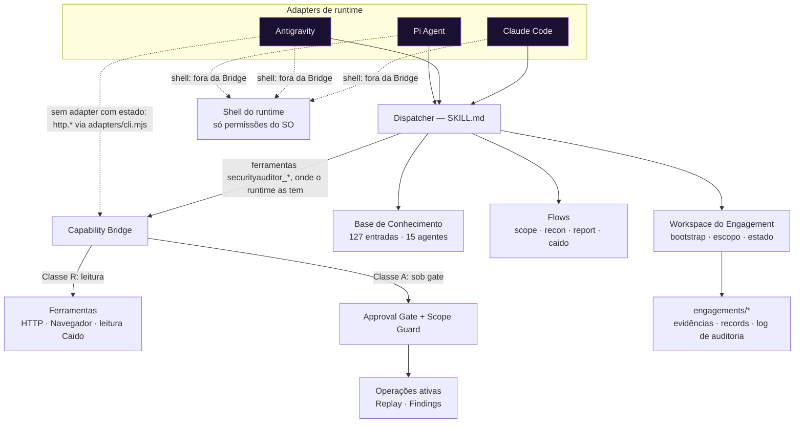
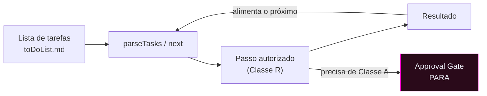
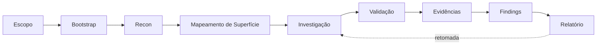

<!--
  SYNAPSE — README (pt-BR)
  Antigo "SecurityAuditor / HackBot". O nome legado é preservado nos relatórios históricos de arquitetura
  (docs/architecture-review/) e em identificadores técnicos estáveis
  (nome da skill `security-auditor`, variáveis `SA_*`, diretório de estado `.hackbot/`), por compatibilidade.

  Legenda de status (o vocabulário honesto do projeto):
  IMPLEMENTED = existe no código · TESTED OFFLINE = teste determinístico executado ·
  VALIDATED REAL = comprovado em runtime/instância real · PARTIAL = só parte da dimensão está comprovada ·
  BLOCKED = parado por requisito ausente ou recusa · NOT RUN = não executado nesta fase ·
  PLANNED = no roadmap, não implementado.
-->

<p align="center">
  
</p>

<h1 align="center">SYNAPSE</h1>
<p align="center"><strong>Agentic Offensive Security Harness</strong></p>
<p align="center"><em>Connect Intelligence. Orchestrate Security.</em></p>

<p align="center">
  
  
  
  
  
</p>

<p align="center">
  <a href="#visão-geral">Visão Geral</a> ·
  <a href="#conceitos-centrais">Conceitos</a> ·
  <a href="#capacidades">Capacidades</a> ·
  <a href="#arquitetura">Arquitetura</a> ·
  <a href="#instalação">Instalação</a> ·
  <a href="#início-rápido">Início Rápido</a> ·
  <a href="#modos-de-operação">Modos</a> ·
  <a href="#integração-com-o-caido">Caido</a> ·
  <a href="#testes-e-validação">Testes</a> ·
  <a href="#solução-de-problemas">Solução de Problemas</a> ·
  <a href="#documentação">Documentação</a> ·
  <a href="#roadmap">Roadmap</a>
</p>

> **O SYNAPSE é um harness agnóstico de runtime.** Ele equipa um agente de IA com uma base de conhecimento
> ofensiva curada, um modelo rigoroso de autorização por aprovação em fases, uma camada determinística de
> capacidades e um workspace persistente de engagement, para que o agente e seu operador humano conduzam juntos
> uma avaliação real, sob supervisão. Os runtimes prioritários são **Pi Agent** e **Google Antigravity**; o Claude Code é
> suportado como runtime adicional. A validação difere por runtime: veja a
> [matriz de compatibilidade](#matriz-de-compatibilidade-de-runtimes).

<p align="center"></p>

## Visão Geral


O SYNAPSE transforma um agente de IA genérico em um operador disciplinado de testes de intrusão. Onde um scanner executa
assinaturas fixas, o SYNAPSE dá ao agente **julgamento com limites**: encaminha cada pedido à técnica certa
em uma base de 127 entradas, exige um gate de autorização antes de qualquer operação ativa, mantém todo
artefato dentro de um engagement isolado e registra a proveniência de cada finding.

**Por que existe.** Ferramentas ofensivas autônomas são perigosas quando agem sem escopo, aprovação ou
auditabilidade. A tese do SYNAPSE é a **autonomia supervisionada**: o agente pode ler, analisar, planejar e encadear
passos autorizados por conta própria, mas toda ação que muda estado ou sai para o exterior para em um gate explícito.
O operador mantém o controle; o agente elimina o trabalho braçal.

**Harness vs. scanner.**

| | Scanner | SYNAPSE |
|---|---|---|
| Lógica | Assinaturas fixas | Raciocínio do agente sobre uma KB curada |
| Escopo | Lista de alvos | Engagement + Scope Guard, isolamento por projeto |
| Ações | Dispara e esquece | Aprovação em fases; operações ativas sob gate |
| Saída | Findings brutos | Findings com proveniência + Investigation Records |
| Runtime | Binário independente | Portável entre runtimes de IA |

**Papéis.** O **operador** autoriza o escopo, aprova operações ativas e é dono do veredito. O
**agente** descobre superfície, analisa tráfego, propõe e encadeia passos autorizados e redige evidências,
sempre honesto sobre o que está IMPLEMENTED, TESTED OFFLINE, VALIDATED REAL ou NOT RUN.

<p align="center"></p>

## Conceitos Centrais


| Conceito | O que é |
|---|---|
| **Engagement** | Workspace isolado de avaliação: nove buckets numerados, `scope.md`, estado (`.hackbot/`), evidências, log de auditoria. Vários engagements coexistem; um fica ativo por sessão. |
| **Escopo** | `scope.md` declara os hosts em escopo. O **Scope Guard** valida contra ele todo alvo ativo (Regra 0). A presença de um host no tráfego capturado **nunca** é autorização para agir. |
| **Workspace** | `tools/workspace/engagement.mjs`: bootstrap, seleção, confinamento (seguro contra symlinks), leitura de tarefas, retomada. Toda escrita fica confinada ao engagement ativo. |
| **Dispatcher** | A skill em Markdown (`SKILL.md`) que encaminha palavras-chave e flows para entradas da KB, agentes e ferramentas. Ponto de entrada único; só existe um. |
| **Flows** | `workflows/flows-*.md`: scope, recon, report, intake, proxy, agents, status. Investigação Caido: `references/flows-caido-investigation.md`. |
| **Agentes** | 15 categorias da KB em `agents/` (host-inventory, web-testing, code-review, forge, …). |
| **Skills** | Skills de entrada expostas pelo runtime (por exemplo, `/iniciar-pentest`, `/investigar`, `/modo`). Descobertas localmente por runtime, nunca instaladas globalmente. |
| **KB** | 112 técnicas (T) + 15 blueprints de forge (B) = **127** entradas, cada uma com payloads reais, tier e campos de escalonamento. |
| **Capacidades** | O único meio de tocar o mundo externo, pela **Capability Bridge**. Classe R (leitura) vs. Classe A (ativa, sob gate). |
| **Execution Context** | `{investigationId, scope, allowedCapabilities}` aberto por investigação; a Bridge não aceita nada fora dele. |
| **Copilot** | Análise **determinística, sem LLM** e somente leitura do tráfego capturado. O mesmo nome designa o **modo** padrão da sessão (`/modo`). |
| **Autopilot** | Loop supervisionado que encadeia passos autorizados da lista de tarefas do engagement; para em todo gate. |
| **Caido** | Análise somente leitura do HTTP History + operações ativas supervisionadas e sob gate (Replay/Findings). |
| **Evidências / Investigation Records** | Captura com proveniência preservada; um Record só é escrito com hipótese fundamentada contra um alvo autorizado. |

<p align="center"></p>

## Capacidades


O status segue com honestidade a matriz de prontidão do projeto
([`docs/handbook/operator/readiness.md`](docs/handbook/operator/readiness.md)). VALIDATED REAL abaixo indica o
runtime em que foi comprovado; o detalhe por runtime está na [matriz de compatibilidade](#matriz-de-compatibilidade-de-runtimes).

| Capacidade | Status | Notas |
|---|---|---|
| Bootstrap / retomada / multi-engagement | IMPLEMENTED · TESTED OFFLINE · **VALIDATED REAL** (Claude Code; Pi em dados sintéticos) | 9 buckets + docs, idempotente, isolado |
| Scope Guard / aprovação em fases | IMPLEMENTED · TESTED OFFLINE · **VALIDATED REAL** (Claude Code); Pi: só a recusa de fora de escopo na Bridge, em dados sintéticos | Regra 0 vale mesmo com aprovação em lote |
| Capability Bridge (Classe R / Classe A) | IMPLEMENTED · TESTED OFFLINE · `http.inspect` **VALIDATED REAL** (Pi, fixture em loopback) | Contrato de envelope; aprovação por ação. Operações sob aprovação de fato executadas: **NOT RUN** |
| Recon e mapeamento de superfície | IMPLEMENTED · TESTED OFFLINE | `flows-recon`, `flows-scope` |
| KB de testes web / API | IMPLEMENTED · TESTED OFFLINE | `agents/web-testing` (15), `agents/web-inventory` (8) |
| Runtime de navegador | IMPLEMENTED · TESTED OFFLINE | Playwright-core, navegação real em loopback |
| Caido HTTP History (somente leitura) | IMPLEMENTED · TESTED OFFLINE · **VALIDATED REAL** (Claude Code) | 21 requisições lidas ao vivo; anotadas por escopo |
| Caido Copilot (determinístico) | IMPLEMENTED · TESTED OFFLINE | análise de endpoints e parâmetros sem LLM |
| Caido ativo supervisionado (Replay/Findings) | IMPLEMENTED · TESTED OFFLINE · real **NOT RUN** | Sob gate; fora de escopo é bloqueado mesmo se aprovado |
| Autopilot (encadeamento supervisionado) | IMPLEMENTED · TESTED OFFLINE · **VALIDATED REAL** (Claude Code; Pi em dados sintéticos) | 2 transições autônomas + parada no gate |
| Copilot (execução conduzida pelo operador) | IMPLEMENTED · TESTED OFFLINE · **VALIDATED REAL** (Claude Code; Pi em dados sintéticos) | ler → analisar → persistir → apresentar |
| Investigation Records + evidências | IMPLEMENTED · TESTED OFFLINE | proveniência preservada |
| Microferramentas de forge | IMPLEMENTED · TESTED OFFLINE | 15 blueprints |
| Inteligência whitebox (segregada) | IMPLEMENTED (F1) · restante **PLANNED** | Ingestão de GitHub/Confluence/STRIDE no roadmap |
| Pipeline de relatórios | IMPLEMENTED (templates/bibliotecas) · plugin no Caido **PLANNED** | `reports/` |

<p align="center"></p>

## Arquitetura


O SYNAPSE é modular e agnóstico de runtime. Um adapter de runtime carrega o dispatcher em Markdown; o dispatcher
encaminha para a KB e os flows; ações externas passam **somente** pela Capability Bridge; todo o estado fica no
workspace do engagement. O Pi tem adapter nativo da Bridge; no Antigravity, o único caminho até a Bridge é o
adapter CLI sem estado, então flows como `/investigar` **não** são protegidos pela Bridge lá (veja a
[matriz de compatibilidade](#matriz-de-compatibilidade-de-runtimes)).



**Invariantes principais.** Um único dispatcher. A Bridge é a única superfície externa **das ferramentas do próprio harness**.
Modos **não** concedem capacidade; só descrevem a postura. O Scope Guard valida todo alvo ativo; o
isolamento de projeto (`_caidoAssoc`) prende as leituras ao projeto associado. Ler dados capturados nunca
autoriza agir sobre eles.

> **A Bridge restringe as próprias ferramentas, não o agente.** O shell genérico de um runtime fica fora dela: o `bash` do Pi, por
> exemplo, não tem sandbox e pode editar o arquivo de contextos ou alcançar hosts diretamente. Contenção real exige
> isolamento no nível do sistema operacional. Veja [Limitações](#limitações).

<p align="center"></p>

## Instalação

> O SYNAPSE é um **harness central com ativação local por projeto**: skills **nunca** são instaladas
> globalmente. Cada runtime descobre o harness do seu jeito. Requisitos: **Node.js ≥ 22** (test
> runner nativo, `fetch`, leitura nativa de `.env`), `git`. Opcional: uma instância desktop do Caido e um navegador
> para o Playwright-core (detectado automaticamente).

```bash
git clone <seu-repo-privado> SYNAPSE && cd SYNAPSE
cd tools/web-runtime && npm install && cd -   # dependências de runtime (reproduzíveis; não versionadas)
cp .env.example .env                            # preencha SA_ENGAGEMENT_ROOT e, se precisar, CAIDO_BASE_URL / CAIDO_TOKEN
node tools/preflight/cli.mjs doctor             # verifica o ambiente e os fatos do runtime
```

Esse `.env` é central, portanto **não** chega a todos os projetos. Só configuração simples e conhecida vale em toda parte. `CAIDO_TOKEN` só é carregado para os comandos que precisam dele,
na raiz do harness ou em um projeto ativado com `--caido`, cuja decisão fica ao lado do `.env`, por caminho real, e não no
projeto; `SA_ENGAGEMENT`, `SA_SESSION_ID`, `CAIDO_PROJECT_ID` e outras
chaves ligadas a contexto só valem na raiz do harness; chave desconhecida é retida. Variáveis já exportadas prevalecem; `SA_SKIP_ENV_FILE=1` ignora o arquivo. Isso reduz
exposição acidental e não é uma barreira: um agente com shell consegue ler o arquivo
([guia de configuração](docs/handbook/operator/configuration.md)).

A ativação linka o harness em um diretório de projeto e declara runtimes. `--runtime` aceita
`claude-code`, `pi`, `antigravity`, `all` ou uma lista separada por vírgulas (`pi,antigravity`). Sem a flag, a primeira
ativação declara `claude-code` e uma reativação mantém os runtimes do marcador. Valores desconhecidos são
rejeitados. Reativar com outro conjunto adiciona ou remove os links `.pi/` e `.agents/` conforme o caso.

### Pi Agent (runtime primário)

```bash
# Linka o harness em um projeto (nada é registrado globalmente):
node <harness>/tools/activation/cli.mjs activate --project <dir> --runtime pi
cd <dir>
# Projeto que você revisou: confie nele nesta execução; skills rodam como /skill:<nome>:
pi -a --provider openai-codex --model gpt-6-luna --thinking low
# Repositório de cliente ou qualquer coisa não revisada: ignore o que é local e carregue só o SYNAPSE:
pi -na --skill <harness>/SKILL.md --skill <harness>/.claude/skills \
  -e <harness>/tools/web-runtime/adapters/pi/extension-pi.mjs --provider openai-codex --model gpt-6-luna --thinking low
# Em ambos os casos, as ferramentas da Capability Bridge precisam de um Execution Context escrito pelo operador:
SECAUDIT_BRIDGE_CONTEXTS=<ctx.json> pi -a
```

- **Confiança:** `-a` e `/trust` carregam todo recurso local do projeto, e `.pi/extensions` do projeto é **código que roda na
  inicialização** (comprovado por `tools/web-runtime/test-pi-trust.mjs` contra o Pi real). `activate` e `status` listam o que o projeto
  fornece além dos links do SYNAPSE. Arquivos de contexto como `AGENTS.md` carregam mesmo com `-na`.
  O `.pi/settings.json` do projeto depende de confiança; modos não interativos o ignoram sem `-a`.
- **Modelo:** o modelo padrão do Pi pode não ser da OpenAI, então passe provedor e modelo explicitamente. Autentique pelo
  próprio Pi (`/login`); o SYNAPSE não guarda credenciais de modelo.
- **Arquivos de contexto:** a ativação linka `AGENTS.md` (um ponteiro mínimo para `SKILL.md`). `bootstrap` também gera
  `AGENTS.md` **na raiz do engagement** quando o projeto declara `pi` ou `antigravity`.
- **Pela raiz do harness:** `pi --skill SKILL.md -e tools/web-runtime/adapters/pi/extension-pi.mjs` também funciona,
  sem ativação.
- **Evite:** `pi install <path>` registra globalmente em `settings.json`: não é o caminho recomendado e **não foi
  exercitado**.
- **Degradação:** sem despacho paralelo, o brief dos agentes roda como fase sequencial
  (`workflows/flows-agents.md`).
- **O conhecimento não é copiado:** o adapter aponta para `skills/`.
- **Status:** **VALIDATED REAL em dados sintéticos, com conclusão de tarefas instável** (Linux, `--mode json` não interativo). TUI interativa,
  `/trust`, alvos reais, Caido e Windows: **NOT RUN**. Guia:
  [`docs/handbook/operator/pi-agent.md`](docs/handbook/operator/pi-agent.md).

### Google Antigravity (runtime primário)

```bash
# Linka o harness em um projeto (nada é registrado globalmente):
node <harness>/tools/activation/cli.mjs activate --project <dir> --runtime antigravity
cd <dir>
agy models           # lista os ids de modelo disponíveis para sua conta
agy -p /skills       # lista as skills sem turno de modelo; o dispatcher e as 13 skills do SYNAPSE devem aparecer
```

- **CLI:** `agy` é uma CLI agêntica headless: `agy -p "<prompt>" --model <id> --output-format json|stream-json --print-timeout 120s`,
  com `--continue` e `--conversation <id>` para retomar. `agy` sem argumentos é interativo.
- **Descoberta:** a ativação linka `AGENTS.md` e `.agents/skills`: links para as 13 skills e para `SKILL.md` como
  `security-auditor`, um único dispatcher e nenhuma cópia. Comece um prompt com `/security-auditor` para carregá-lo; a evidência é um evento `read_file` em
  `stream-json`, não uma resposta plausível.
- **Bloqueio headless:** tudo o que precisa de comando de shell é recusado em conta sem `--mode auto`. A
  decisão de como prosseguir é do operador: veja o
  [guia do Antigravity](docs/handbook/operator/antigravity.md).
- **Bridge:** não há adapter com estado e **os flows aqui não são protegidos pela Bridge**: sem
  ferramentas `securityauditor_*`, Scope Guard e Approval Gate não se aplicam. `tools/web-runtime/adapters/cli.mjs` é o único caminho
  (`capabilities.*`, `http.*` GET/HEAD). Com `SECAUDIT_BRIDGE_CONTEXTS`, ele usa o contexto desse arquivo, preso ao
  engagement selecionado no projeto; qualquer das formas reporta `operatorVerified: false`, porque quem chama pode ser o próprio
  agente. As operações com estado de `/investigar` não têm caminho aqui.
- **O conhecimento não é copiado:** aponta para `skills/`.
- **Status:** **PARTIAL, não homologado.** Descoberta de skills, carregamento do `AGENTS.md` e abertura do dispatcher por `/security-auditor` são VALIDATED REAL (um prompt natural nem sempre o abre);
  seguir o dispatcher não está verificado, e os cenários de workflow estão BLOCKED em headless.

### Claude Code (runtime adicional)

```bash
# .claude/skills/<nome>/ são diretórios reais, descobertos no INÍCIO DA SESSÃO
node tools/activation/cli.mjs activate --project <dir>   # ativação local em projeto externo, se precisar
# depois abra uma nova sessão; skills como /iniciar-pentest, /investigar, /modo aparecem
```

- **Status:** **VALIDATED REAL** (aceitação S4 em Omarchy/Linux): bootstrap, Copilot, Autopilot supervisionado e
  integração somente leitura com o Caido exercitados ao vivo. Não repetido ao vivo na rodada mais recente; a ativação e os testes offline
  continuam passando.

> **Portão de honestidade:** o SYNAPSE foi projetado para ser agnóstico de runtime, e Pi/Antigravity são os runtimes
> primários pretendidos, mas uma dimensão só é marcada **VALIDATED REAL** em um runtime depois de uma execução real nele. Veja
> [`docs/handbook/operator/runtimes.md`](docs/handbook/operator/runtimes.md).

<p align="center"></p>

## Configuração

| Variável | Obrigatória | Finalidade |
|---|---|---|
| `CAIDO_BASE_URL` | para o Caido | URL base do GraphQL do Caido |
| `CAIDO_TOKEN` | para o Caido | Token Bearer (**nunca impresso / versionado**). Vem do `.env` só na raiz do harness ou com `activate --caido`, registrado ao lado do `.env`, e só para os comandos que precisam dele |
| `SA_ENGAGEMENT_ROOT` | sim, para engagements | Diretório raiz dos engagements (caminho absoluto, fora do harness; dentro dele, só `engagements/` é aceito) |
| `SA_SESSION_ID` | opcional | Sessão separada para o ponteiro do engagement ativo. Projeto ativado ou raiz do harness derivam uma sessão estável sem ela; um valor explícito fica preso ao projeto ou à raiz do harness, e não dá sessão dentro de recursos do harness linkados em projetos. Fora desses dois, é o único meio de ter seleção: sem ela, `use` recusa |
| `SECAUDIT_BRIDGE_CONTEXTS` | para ferramentas da Bridge no Pi | Caminho do JSON de Execution Context escrito pelo operador |
| `SA_SKIP_ENV_FILE=1` | testes | Modo de teste hermético (ignora o `.env`) |

> O prefixo `SA_*` e o diretório de estado `.hackbot/` são **identificadores legados estáveis**, mantidos por
> compatibilidade; o produto se chama SYNAPSE, mas esses contratos técnicos permanecem de propósito.
> Segredos ficam só no `.env` (ignorado pelo Git) e no `.config` de cada engagement, nunca no Git.
> Rode `node tools/preflight/cli.mjs doctor` para verificar a configuração sem expor valores.

<p align="center"></p>

## Início Rápido

O fluxo comum de operação, neutro quanto ao runtime:

1. **Prepare o SYNAPSE**: `npm install` em `tools/web-runtime`, configure o `.env`, rode o `doctor`.
2. **Selecione um runtime**: Pi Agent, Antigravity ou Claude Code, e ative um projeto para ele.
3. **Crie um engagement**: workspace isolado com buckets + `scope.md`.
4. **Defina o escopo**: liste os hosts autorizados em `scope.md`.
5. **Selecione o engagement**: ele passa a ser o ativo da sessão.
6. **Escolha um modo**: Copilot (padrão) ou Autopilot supervisionado.
7. **Inicie o pentest**: recon e mapeamento de superfície dentro do escopo.
8. **Investigue**: analise tráfego e superfície; redija Investigation Records fundamentados.
9. **Revise os resultados**: findings, evidências, proveniência.
10. **Retome**: volte depois; estado e tarefas persistem de forma idempotente.

Os passos de engagement são CLIs simples, idênticas em qualquer projeto ativado e executáveis pelo operador ou pelo agente:

```bash
node tools/workspace/cli.mjs init --name lab --modality blackbox
node tools/workspace/cli.mjs scope --name lab --file <scope.md>   # exige '# Scope' e '## In Scope'
node tools/workspace/cli.mjs use --name lab
node tools/workspace/cli.mjs bootstrap                            # AGENTS.md ou CLAUDE.md, conforme o marcador de ativação
node tools/modes/cli.mjs status
node tools/preflight/cli.mjs preflight --profile core-lab
```

**Pi Agent** (a partir do projeto ativado):

```bash
# Interativo; depois /skill:criar-engagement → /skill:usar-engagement → /skill:iniciar-pentest → /skill:investigar → /skill:modo
pi -a --provider openai-codex --model gpt-6-luna --thinking low

# Não interativo, depois retoma a mesma sessão:
pi -a --mode json --provider openai-codex --model gpt-6-luna --thinking low --session-dir <dir> -- "/skill:engagement-atual"
pi -a --mode json --provider openai-codex --model gpt-6-luna --thinking low --session-dir <dir> --continue -- "Qual é a próxima tarefa?"
```

**Antigravity** (a partir do projeto ativado):

```bash
# Interativo: um humano aprova cada prompt (este caminho está NOT RUN pelo projeto):
agy

# Headless: expansão de skills e leitura de arquivos funcionam; tudo o que precisa de comando de shell, inclusive CLIs de skills, é negado
# salvo decisão contrária do operador:
agy -p "<prompt>" --model <id> --output-format json --print-timeout 120s
```

**Claude Code** (skills por barra, descobertas por sessão):

```text
/criar-engagement   →   /usar-engagement   →   /iniciar-pentest   →   /investigar   →   /modo
```

> O nome de uma skill é o mesmo em todo runtime; a invocação muda: `/skill:<nome>` no Pi, `/<nome>` no
> Antigravity e no Claude Code. Veja na matriz de compatibilidade o que está comprovado em cada um.

<p align="center"></p>

## Modos de Operação




- **Copilot (padrão).** O operador conduz; o agente executa os passos permitidos (Classe R) quando pedido: ler,
  analisar, persistir, apresentar.
- **Autopilot (supervisionado).** O agente encadeia passos autorizados da lista de tarefas, usando cada resultado no
  seguinte, e **para em todo Approval Gate** (qualquer operação Classe A / ativa).
- **Modos não concedem capacidade.** Só definem a postura; a permissão vem sempre de Bridge + Scope Guard +
  Approval Gate. O Autopilot nunca executa operação ativa sem aprovação explícita.
- **Persistência / critérios de parada.** O progresso é idempotente e retomável; o loop para em um gate, em orçamento
  esgotado, em capacidade ausente (→ NOT RUN) ou com a lista de tarefas vazia. Trocar de engagement devolve o modo a
  Copilot.

<p align="center"></p>

## Comandos e Skills

| Camada | O quê | Onde |
|---|---|---|
| Skills do harness | Dispatcher + roteamento da KB | `SKILL.md`, `agents/`, `workflows/flows-*.md` |
| Skills de runtime | Pontos de entrada expostos pelo runtime | Claude Code: `.claude/skills/` · Pi: `.pi/settings.json` (`/skill:<nome>`) · Antigravity: `AGENTS.md` + `.agents/skills` |
| CLI interna | Ferramentas determinísticas | `tools/workspace/cli.mjs`, `tools/modes/cli.mjs`, `tools/preflight/cli.mjs`, `tools/activation/cli.mjs` |
| Capability Bridge | Ações externas | `tools/web-runtime/bridge.mjs` |
| Agentes especializados | Categorias da KB | `agents/<categoria>/` |

A equivalência só existe **onde há suporte real**: a matriz abaixo nunca a inventa.

### Matriz de compatibilidade de runtimes

Os dados do Pi vêm do Pi 1.4.0 com `openai-codex/gpt-6-luna --thinking low`, em **dados sintéticos**, Linux,
`--mode json` não interativo. Os do Antigravity vêm do antigravity-cli 1.5.1 com `gemini-3.8-flash-low`,
headless.

| Dimensão | Pi Agent | Antigravity | Claude Code |
|---|---|---|---|
| Ponto de entrada | `pi -a` em projeto ativado e revisado, ou `pi -na` com caminhos explícitos; `/skill:<nome>` | `agy` em projeto ativado; `/<nome>` | `.claude/skills/` (início da sessão) |
| Descoberta de skills | **VALIDATED REAL** | **VALIDATED REAL** (13/13) | **VALIDATED REAL** |
| Ativação local | **VALIDATED REAL** | **VALIDATED REAL** | **VALIDATED REAL** |
| Dispatcher | **VALIDATED REAL** (lido pelo agente) | **VALIDATED REAL** por `/security-auditor`: `read_file` no log e marcador aleatório do arquivo; um prompt natural o abre na maioria das execuções, não em todas; segui-lo não está verificado | **VALIDATED REAL** |
| Workspace / Bootstrap | **VALIDATED REAL** | **BLOCKED** em headless; interativo NOT RUN | **VALIDATED REAL** |
| Troca de modo | **VALIDATED REAL** | **BLOCKED** em headless; interativo NOT RUN | **VALIDATED REAL** |
| Capacidades (Bridge) | **VALIDATED REAL**: `http.inspect` em fixture de loopback, fora de escopo recusado | **PARTIAL**: sem adapter com estado, os flows não têm proteção da Bridge; `adapters/cli.mjs` TESTED OFFLINE, só sem estado; pelo agente BLOCKED | TESTED OFFLINE |
| Operações sob aprovação de fato executadas | **NOT RUN** | **NOT RUN** | **NOT RUN** |
| Caido (somente leitura) | TESTED OFFLINE; ao vivo NOT RUN | **NOT RUN** | **VALIDATED REAL** |
| Copilot / Autopilot | **VALIDATED REAL**: tarefa com efeito em disco; cadeia sobre 2 tarefas seguras parando no gate de Classe A | **BLOCKED** em headless; interativo NOT RUN | **VALIDATED REAL** em laboratório sintético; em tráfego real em escopo: NOT RUN (NO DATA) |
| Persistência / retomada | **VALIDATED REAL** (`--continue`) | **BLOCKED**: a conversa retoma, a leitura de estado é negada | **VALIDATED REAL** |
| Falha controlada | **VALIDATED REAL** | **PARTIAL**: só o caminho de falha de leitura | TESTED OFFLINE |
| Isolamento de projeto | **VALIDATED REAL** | **PARTIAL**: verificado só pela CLI; o shell do agente foi negado | TESTED OFFLINE |
| Uso interativo | **NOT RUN** (TUI, `/trust`) | **NOT RUN** | **VALIDATED REAL** |
| Ponta a ponta ao vivo, alvo real | **NOT RUN** | **NOT RUN** | **PARTIAL**: integração VALIDATED REAL; análise em escopo NOT RUN (NO DATA) |
| Windows | **NOT RUN** | **NOT RUN** | **NOT RUN** |

> **Pi:** a última passada completa de aceitação deu **12/14** (cenários 5 e 12 FAIL; as duas anteriores, 13/14 e 11/14). **O resultado varia entre passadas.** O Pi em si não
> interrompe nada: o modelo encerra o turno antes de concluir em cerca de 1/4 a 1/3 dos prompts compostos (amostras pequenas), e
> as variáveis testadas não explicam essa taxa; `SKILL.md`, políticas, modelo e nível de raciocínio não foram variados. Uma linha enganosa do `AGENTS.md` que o desviava para a Bridge foi corrigida, e nenhuma chamada de ferramenta registrada foi classificada como executada contra
> o host fora de escopo (detecção textual nos logs, sem captura de rede). Veja o [relatório 49](docs/architecture-review/49-pi-reliability-stabilization.md).
> O prompt do Autopilot cita o seletor `next`; uma
> execução anterior sem essa dica chamou `next` uma vez. Isso é validação em dados sintéticos,
> não um pentest de alvo real.
>
> **Antigravity:** cenário 1 PASS (ativação, descoberta); o cenário 2 varia: um prompt natural abre o dispatcher na maioria das execuções, não em todas, enquanto `/security-auditor` o carrega, como mostram um evento `read_file`
> e um marcador aleatório do arquivo; segui-lo não está verificado; cenários 3-11 **BLOCKED** em headless, nunca executados além da
> negação de permissão; o cenário 12 PASS cobre só um caminho de falha de leitura; cenário 13 **PARTIAL**. O Antigravity
> **não está homologado**.
>
> **Claude Code:** validado no S4 (integração e experiência); a cadeia análise → leads → Investigation Record
> em tráfego real em escopo continua NOT RUN (NO DATA).
>
> **Codex** não faz parte desta distribuição (decisão de escopo). `openai-codex` acima é o nome de um provedor de modelo
> do Pi, não uma integração de runtime.

<p align="center"></p>

## Fluxos de Pentest



- **Blackbox / Graybox / Whitebox** são modalidades suportadas. A inteligência whitebox é **segregada** e
  parcialmente implementada (F1); a ingestão mais profunda (GitHub/Confluence/STRIDE) está no roadmap e **não** é
  apresentada como completa.
- Todo passo ativo passa pelo Scope Guard e pelo Approval Gate. As evidências preservam a proveniência; um
  Investigation Record só é escrito com hipótese fundamentada contra um alvo autorizado.

<p align="center"></p>

## Integração com o Caido


O SYNAPSE fala com o Caido por GraphQL (`<baseUrl>/graphql`, `Authorization: Bearer <token>`).

- **Projeto associado.** Todas as leituras ficam presas ao projeto associado ao engagement (`_caidoAssoc`);
  acesso entre projetos é recusado (`caido-project-mismatch`).
- **HTTP History (somente leitura).** `caido.history` / `caido.request` retornam **todos** os registros capturados do
  projeto associado, cada um **anotado** como `inScope` ou fora de escopo. Ler dados já capturados não contata nenhum
  host externo, então isso **não** é retido pelo Scope Guard. A proveniência
  (source / projectId / requestId / responseId / timestamp) é preservada.
- **HTTPQL, paginação e campos** são suportados; `currentProject` é a fonte de verdade em instâncias locais (o
  campo `projects`, com `@cloud`, degrada para vazio).
- **Copilot** faz análise determinística, sem LLM, de endpoints e parâmetros sobre o History.
- **Operações ativas supervisionadas.** `caido.replay.run` e `caido.findings.create` são **Classe A**: validam
  o alvo contra `scope.md` **mesmo com aprovação em lote** e exigem aprovação por ação.
  **Observar um host no History nunca é autorização para agir contra ele.**
- **Limitação conhecida.** Importar ou gerar workflows nativos do Caido é **pós-MVP** (o SDL expõe uma `definition`
  opaca); não bloqueia o núcleo.

<p align="center"></p>

## Estrutura do Projeto

```text
SYNAPSE/
├── SKILL.md                     # Dispatcher (ponto de entrada; nome da skill: security-auditor [legado])
├── AGENTS.md                    # Ponteiro mínimo para SKILL.md nos runtimes que o carregam; não concede permissões
├── README.md
├── manifest-h0.json             # Manifesto da KB (127 entradas)
├── .env.example  .config.example
├── .gitignore
├── adapters/                    # Docs dos adapters de runtime: pi-agent · antigravity · claude-code
├── agents/                      # Base de conhecimento: 15 categorias (112 técnicas)
├── workflows/  references/      # Flows (scope/recon/report/…) + templates, doutrina e flow de investigação Caido
├── policies/                    # authorization-gate · native-tooling-doctrine · verification-contract
├── skills/                      # Corpos da KB (técnicas T + blueprints B = 127)
├── reports/                     # Templates e bibliotecas de relatório
├── intake/                      # Fila de entrada da KB
├── images/                      # Banner e assets do README
├── tools/
│   ├── workspace/               # engagement.mjs, bootstrap, cli, autopilot
│   ├── web-runtime/             # bridge.mjs, backends/caido.mjs + caido-active.mjs, caido-copilot, adapters/pi
│   ├── modes/                   # postura copilot / autopilot
│   ├── preflight/               # doctor, env-loader
│   ├── activation/              # ativação local por projeto
│   └── acceptance/              # aceitação em runtime real (separada das suítes; custa dinheiro)
├── .claude/                     # Skills do Claude Code (diretórios reais) + hooks + settings
├── .pi/                         # Configuração de projeto do Pi (skills + extensão da Bridge; depende de confiança)
├── .agents/                     # Skills do Antigravity (link para .claude/skills)
├── docs/
│   ├── handbook/                # Handbook do operador + engenharia
│   └── architecture-review/     # Revisões históricas 00–49 e archive/ (rastreabilidade)
└── engagements/                 # Dados locais de engagement (ignorados pelo Git)
```

<p align="center"></p>

## Testes e Validação

Duas trilhas separadas, cujas métricas **nunca se misturam**.

**Offline (39 suítes + validador da KB).** Todas as suítes usam o test runner nativo do Node (sem dependências externas de teste), não fazem
chamada a modelo e são herméticas com `SA_SKIP_ENV_FILE=1`.

`tools/acceptance/rejudge.mjs` reavalia logs salvos, somente leitura e sem modelo. `tools/acceptance/experiment.mjs` roda repetições pareadas
sob tetos de execuções e de custo, sem retries; pré-visualize com `--dry-run`. O tráfego ao host fora de escopo é inferido, não capturado.

```bash
# Validador da KB: deve reportar T=112/112, B=15/15, total=127/127
node docs/architecture-review/validate_h0.mjs . docs/architecture-review/baseline/manifest.json

# Suítes representativas
node tools/workspace/test-engagement.mjs        # workspace
node tools/workspace/test-bootstrap.mjs         # bootstrap (18)
node tools/workspace/test-multi-engagement.mjs  # multi-engagement (31)
node tools/workspace/test-skills.mjs            # contrato das skills (62)
node tools/workspace/test-autopilot.mjs         # loop do autopilot (13)
node tools/workspace/test-runtime-contract.mjs  # sessões, roots, bootstrap por runtime (59)
node tools/modes/test-modes.mjs                 # modos (18)
node tools/web-runtime/test-bridge.mjs          # capability bridge
node tools/web-runtime/test-caido.mjs           # leitura caido + escopo (21)
node tools/web-runtime/test-caido-copilot.mjs   # copilot determinístico (24)
node tools/activation/test-activation.mjs       # ativação (18)
node tools/activation/test-runtime-links.mjs    # conjuntos de links por runtime (44)
node tools/preflight/test-preflight.mjs         # preflight / doctor
```

> Os testes `test-pi-adapter` / `test-pi-entry` / `test-pi-rpc` são **testes de integração com o Pi real** (exigem
> `PI_PKG_DIR` / `PI_BINARY`); sem essas variáveis ficam **BLOCKED / NOT RUN**, o que não é regressão
> (`test-pi-entry` e `test-pi-rpc` saem com 1 e um erro que nomeia a variável ausente).

**Aceitação em runtime real (separada, custa dinheiro).** Consome orçamento de modelo, então recusa começar sem
`--accept-model-cost`, e `--harness` tem de ser um export sem `.env` nem `engagements/`. O veredito vem de chamadas
de ferramenta no log JSON e de efeitos em disco, nunca só do texto do modelo.

```bash
node tools/acceptance/runtime-acceptance.mjs --runtime pi|antigravity --harness <export> --out <dir> --accept-model-cost
```

<p align="center"></p>

## Solução de Problemas

| Sintoma | Causa | Ação |
|---|---|---|
| O Pi não vê as skills do SYNAPSE nem as ferramentas da Bridge | O `.pi/settings.json` do projeto depende de confiança | Em projeto revisado, `pi -a` ou `/trust`; caso contrário, `pi -na` com caminhos explícitos |
| `no unambiguous project context` | Fora de projeto ativado e da raiz do harness (subdiretório do harness ou repositório aninhado não contam), ou marcador ilegível | Rode da raiz, ative o projeto ou defina `SA_SESSION_ID` para automação; comandos de leitura também aceitam `--name` |
| `CAIDO_TOKEN withheld` | Sem opt-in deste projeto neste harness: nunca concedido, movido, renomeado, copiado ou ativado antes de a decisão sair do projeto | Se confiar, o operador roda `activate --project <dir> --caido` ou exporta o token para aquele comando |
| `SA_ENGAGEMENT=… conflicts` | A variável diverge da seleção deste contexto; nada foi gravado | `unset SA_ENGAGEMENT` ou `use --name <n>` |
| `SA_ENGAGEMENT=… selects nothing here` | A variável está definida em um projeto, ou em repositório aninhado nele, sem seleção; pode ter sobrado de outro cliente; nada foi gravado | `use --name <n>`, `--name <n>` ou `unset SA_ENGAGEMENT` |
| `activation marker … is a symbolic link` | O marcador é um link; nunca é seguido | `deactivate --project <dir> --repair`, depois `activate` |
| `invalid-marker` | O marcador de ativação está malformado; nada foi alterado | `deactivate --project <dir> --repair`, depois `activate` |
| O Pi usa um modelo inesperado | O modelo padrão do Pi pode não ser da OpenAI | Passe `--provider` e `--model` |
| O Pi lista skills que não são do SYNAPSE | O `HOME` real do Pi carrega também suas skills globais | Esperado; o SYNAPSE soma a elas e não muda nada global |
| Ferramentas da Bridge recusam com `no-trusted-context` | `SECAUDIT_BRIDGE_CONTEXTS` ausente ou inválido | Aponte para o JSON escrito pelo operador |
| `agy` sai com 0, `status: SUCCESS` e resposta vazia | Uma ferramenta foi negada automaticamente em headless | Inspecione `denied_actions`; veja o [guia do Antigravity](docs/handbook/operator/antigravity.md) |
| `agy -p /skills` não mostra skills do SYNAPSE | Projeto não ativado para o Antigravity | `activate --project <dir> --runtime antigravity` |
| `no active engagement` em um projeto | A seleção é por projeto ativado | `node tools/workspace/cli.mjs use --name <n>` nesse projeto |
| `root-inside-harness` | `SA_ENGAGEMENT_ROOT` aponta para dentro do harness | Use um diretório fora dele, ou o `engagements/` do harness |
| `unknown runtime` / `bad-runtime` | Valor não suportado pelo comando | Use os valores listados no erro |
| O modo voltou a Copilot | Trocar de engagement redefine o modo | Selecione o modo de novo |

Tabela completa: [`docs/handbook/operator/troubleshooting.md`](docs/handbook/operator/troubleshooting.md).

<p align="center"></p>

## Documentação

| Área | Caminho |
|---|---|
| Início / Handbook do operador | [`docs/handbook/`](docs/handbook/) |
| Guia do Pi Agent | [`docs/handbook/operator/pi-agent.md`](docs/handbook/operator/pi-agent.md) |
| Guia do Antigravity | [`docs/handbook/operator/antigravity.md`](docs/handbook/operator/antigravity.md) |
| Runtimes (Pi / Antigravity / Claude) | [`docs/handbook/operator/runtimes.md`](docs/handbook/operator/runtimes.md) · [`adapters/`](adapters/) |
| Prontidão / matriz do MVP | [`docs/handbook/operator/readiness.md`](docs/handbook/operator/readiness.md) |
| Índice da documentação (atual vs. histórico) | [`docs/README.md`](docs/README.md) |
| Monitor do histórico ao vivo do Caido | [`docs/handbook/10-caido-live-history-monitor.md`](docs/handbook/10-caido-live-history-monitor.md) |
| Roadmap de capacidades | [`docs/architecture-review/08-capability-roadmap.md`](docs/architecture-review/08-capability-roadmap.md) |
| Revisões históricas (00–49) | [`docs/architecture-review/`](docs/architecture-review/) |

<p align="center"></p>

## Roadmap

| Estado | Itens |
|---|---|
| **Validado em real** | Bootstrap/retomada, Scope Guard, Copilot, Autopilot supervisionado, Caido somente leitura (Claude Code / Omarchy); da ativação ao gate do Autopilot, retomada e `http.inspect` da Bridge (Pi, dados sintéticos); descoberta de skills, carregamento do `AGENTS.md` e abertura do dispatcher (Antigravity) |
| **Testado offline** | Capability Bridge, Caido ativo (Replay/Findings), monitor, investigation records, forge, adapter do Pi, isolamento de engagement, escopo de credenciais, fronteira de confiança do adapter CLI |
| **Planejado** | Ingestão whitebox (GitHub/Confluence/STRIDE), plugin de evidências/relatórios no Caido, credential store/sonda ao vivo |
| **Pós-MVP / V2** | Importar ou gerar workflows nativos do Caido (fora do MVP obrigatório) |
| **Validação pendente** | Análise em tráfego real em escopo (depende de dados, sem defeito de produto); Pi em alvos reais, interativo e com Caido; Antigravity além do bloqueio de permissão, seguindo o dispatcher e com caminho de Bridge com estado; operações sob aprovação de fato executadas; Windows |

<p align="center"></p>

## Limitações

- **A validação do Pi é em dados sintéticos**, Linux, não interativa. TUI interativa, fluxo `/trust`, alvos reais,
  Caido, Windows e operações sob aprovação de fato executadas estão **NOT RUN**.
- **O Antigravity é parcial e não homologado.** Skills, `AGENTS.md` e a abertura do dispatcher estão verificados, mas o
  agente segui-lo não, e comandos de shell em headless são negados. Uma execução negada ainda sai com 0, `status: SUCCESS` e
  resposta vazia, então wrappers têm de inspecionar `denied_actions`. Não há adapter de Bridge com estado, portanto `/investigar` não tem
  proteção da Bridge lá. Não leia "runtime primário" como "validado".
- **A Bridge restringe as próprias ferramentas, não o agente.** O `bash` do Pi não tem sandbox: pode ler o `.env` central, editar o
  arquivo de contextos ou alcançar hosts diretamente. Contenção exige isolamento no nível do sistema operacional; o SYNAPSE não traz sandbox.
- **O isolamento é por contexto, não por dados de cliente.** Uma seleção não atravessa projetos, mas `list` e `--name` ainda veem todos os
  engagements sob um mesmo `SA_ENGAGEMENT_ROOT`, e um `SA_ENGAGEMENT` exportado seleciona só em diretório comum ou na raiz do harness, com aviso (em projeto, tem de coincidir com a seleção, ou os comandos recusam). Use um root por
  cliente.
- **O opt-in do Caido protege contra conteúdo do projeto, não contra um shell do mesmo usuário.** A decisão fica ao lado do `.env`, fora do
  projeto, então um repositório não consegue conceder o token a si mesmo. Um processo rodando como o mesmo usuário ainda pode ler o `.env` e editar esse arquivo.
- **O `HOME` real do Pi** carrega também as skills globais do usuário junto com o SYNAPSE.
- **A análise em tráfego real em escopo** depende de uma captura em escopo feita pelo operador (depende de dados).
- **Operações ativas no Caido** exigem uma instância real autorizada e aprovação por ação.
- **A geração de workflows nativos do Caido** é pós-MVP.
- O SYNAPSE apoia **somente** testes de segurança **autorizados**. Nunca trata tráfego observado como autorização e
  recusa uso destrutivo, DoS, ataque em massa ou evasão de detecção.

<p align="center"></p>

## Desenvolvimento

- **Adicionar técnica/blueprint:** siga `references/template-technique.md`; mantenha a KB em 127 (ou atualize
  `manifest-h0.json` + baseline e rode o validador de novo).
- **Adicionar flow:** `workflows/flows-*.md`, ligado pelo dispatcher.
- **Adicionar capacidade:** estenda a Bridge (`BRIDGE_OPS`), classifique em Classe R ou Classe A, adicione o gate e um
  teste determinístico. Nunca contorne o Scope Guard nem o Approval Gate.
- **Convenções:** um único dispatcher; a Bridge é a única superfície externa; modos não concedem capacidade; toda afirmação é
  rotulada pelo seu estado de evidência. Rode a suíte completa + validador antes de qualquer commit.

---

<p align="center">
  
  &nbsp;<strong>SYNAPSE</strong> — Connect Intelligence. Orchestrate Security.
</p>
<p align="center"><sub>Antigo SecurityAuditor / HackBot · agnóstico de runtime · autonomia supervisionada · somente testes autorizados</sub></p>
