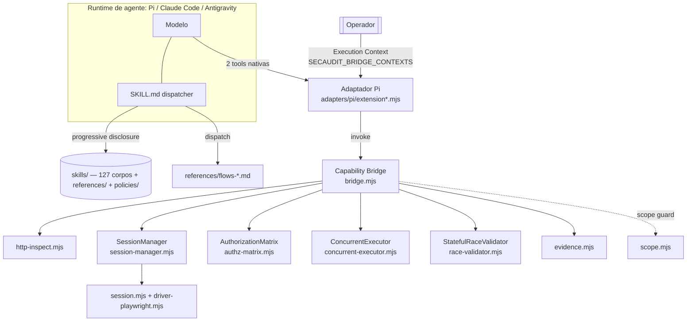
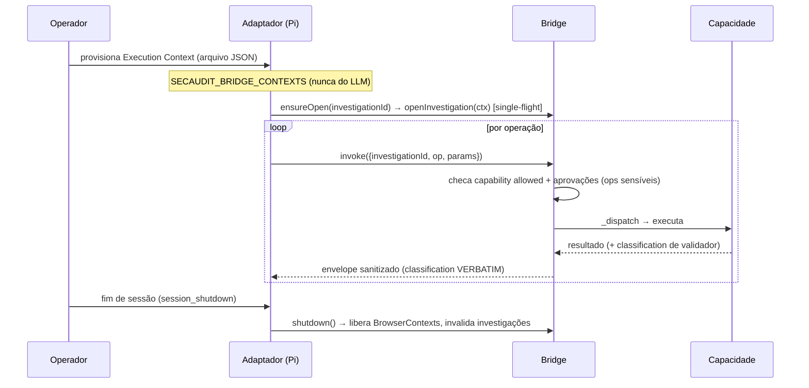

# 1 — Arquitetura e Runtime

## 1.1 Propósito e princípios

O SYNAPSE (SecurityAuditor) é um **copiloto de pentest** empacotado como **Agent Skill portável, 100%
Markdown**, com capacidades executáveis sobre a web isoladas em um **Web Runtime** Node. Princípios
derivados do código e das policies:

- **Progressive disclosure** ✅ — só o `SKILL.md` é sempre carregado; o resto (flows, KB, policies) entra
  sob demanda via a *Loading Chain* (ver cap. 2). Minimiza custo de contexto.
- **Native-tooling doctrine** ✅ — o que roda *no alvo* prefere ferramentas nativas do alvo; escalar
  para Tier-1 exige justificativa de uma frase (`policies/native-tooling-doctrine.md`).
- **Trust boundary no Execution Context** ✅ — escopo, capacidades e aprovações vêm do **operador**, nunca
  do LLM (`bridge.mjs::openInvestigation`, cap. 3/5).
- **Classifier preservation** ✅🧪 — a Bridge copia o veredito dos validadores **verbatim** e nunca o
  promove (`bridge.mjs::_ok`, cap. 3/4).
- **Fallback nativo** ✅ — integrações externas (navegador, futuramente Caido) são aceleradores com
  degradação graciosa; o núcleo funciona sem elas.

## 1.2 Visão geral dos componentes

| Componente | Arquivo(s) | Papel | Status |
|------------|-----------|-------|--------|
| Dispatcher / skill | `SKILL.md`, `references/flows-*.md` | roteia gatilhos → flows → arquivos | ✅ 🧪 (roteamento: [16]) |
| Knowledge Base | `skills/**` (127 corpos), `references/pattern-index.md` | técnicas T[N]/blueprints B[N] | ✅ 🧪 (Validador V1 127/127) |
| Policies imutáveis | `policies/{authorization-gate,verification-contract,native-tooling-doctrine}.md` | contratos sempre carregados | ✅ |
| Capability Bridge | `tools/web-runtime/bridge.mjs` | ponto único `invoke()`; gating; sanitização; preservação de veredito | ✅ 🧪 |
| Pi Adapter | `tools/web-runtime/adapters/pi/extension.mjs` + `extension-pi.mjs` | registra 2 tools nativas no Pi | ✅ 🧪 🤖 |
| HTTP Inspection | `backends/http-inspect.mjs` | GET/headers estáticos, SSRF-safe | ✅ 🧪 |
| Browser Runtime | `backends/browser.mjs`, `session.mjs`, `driver-playwright.mjs` | navegador visual via playwright-core | ✅ 🧪 🤖 |
| Multi-sessão / Identidade | `session-manager.mjs`, `identity-registry.mjs` | N principais isolados | ✅ 🧪 |
| Authorization Matrix | `authz-matrix.mjs`, `resource-registry.mjs` | IDOR/BOLA sequencial | ✅ 🧪 🤖 |
| Concurrency | `concurrent-executor.mjs` | execução concorrente controlada | ✅ 🧪 |
| Race/TOCTOU | `race-validator.mjs` | validador stateful com reset | ✅ 🧪 🤖 |
| Scope Guard | `scope.mjs` | Rule 0 + SSRF | ✅ 🧪 |
| Evidências | `evidence.mjs` | redação + nomes portáveis | ✅ 🧪 |

## 1.3 Runtime e lifecycle

**Runtime principal:** Node (validado em `node-v22.23.1`), sob um runtime de agente. A única dependência de
produção é `playwright-core 1.64.1` (NÃO baixa navegador — dirige Chrome/Edge instalado via
`executablePath`/channel; `session.mjs::detectChannel/probe`). ✅

**Lifecycle de uma investigação** (ver cap. 3 para os contratos):

- **Abertura:** `extension.mjs::ensureOpen` é **single-flight** (H1e-F1/P1) — uma inicialização por
  `investigationId` mesmo sob chamadas concorrentes (cap. 3). ✅ 🧪
- **Execução:** cada `invoke` cria um `AbortController` por operação, combinado ao `signal` do Pi
  (`bridge.mjs::invoke`) — cancelável (cap. 5). ✅ 🧪
- **Encerramento:** `shutdown()` no evento `session_shutdown` libera contexts e invalida investigações; um
  **novo** processo não "recupera" investigações antigas (sem falsa recuperação — `test-bridge` B13). ✅ 🧪

## 1.4 Limites de confiança (resumo; detalhes no cap. 5)

- O **LLM** só nomeia um `investigationId` opaco e pede ops; **não** cria escopo/aprovações.
- O **operador** provisiona o Execution Context (arquivo `SECAUDIT_BRIDGE_CONTEXTS`).
- A **Bridge** é o ponto único de verificação (capability allow-list, aprovações por op/url, sanitização,
  preservação de veredito).

## 1.5 Limitações / lacunas

- Multi-runtime (Claude Code/Antigravity) além do Pi: o adaptador Pi é o validado 🤖; outros adaptadores
  são 📋 (fundação prevista em [05]/[08]).
- `evidenceDir` por investigação não é auto-derivado do contexto (ver cap. 4/5).
