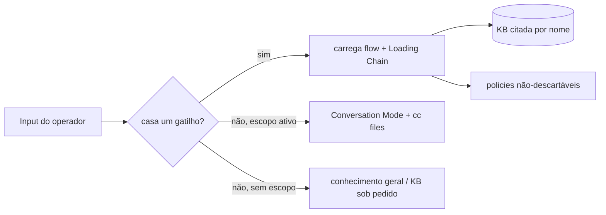

# 2 — Dispatcher, Skills/KB e Flows

## 2.1 O dispatcher (`SKILL.md`)

O `SKILL.md` é a raiz sempre carregada. Suas seções load-bearing (verificadas no arquivo):

- **Flow Dispatch** (`SKILL.md:240`) — tabela **gatilho → flow → arquivos a carregar** (~40 linhas).
- **Context Priority** (`SKILL.md:305`) — "Never droppable": `SKILL.md`,
  `policies/{authorization-gate,verification-contract,native-tooling-doctrine}.md`, o flow ativo, e
  qualquer KB citada por nome no dispatch; ordem de descarte sob pressão de contexto.
- **Loading Chain** (`SKILL.md:314`) — arquivos mínimos por tarefa (progressive disclosure concreto).
- **Action Authorization Gate** (`SKILL.md:61`) e **Refusal Protocol** (`SKILL.md:57`) — imutáveis.

**Roteamento** ✅ 🧪 — confiabilidade de roteamento endereçada em [16]. A seleção é por correspondência de
gatilho; sem gatilho e sem escopo ativo → conhecimento geral; sem gatilho com escopo → Conversation Mode.

## 2.2 Skills, Knowledge Base e progressive disclosure

- **KB = 127 corpos** ✅ 🧪 (`skills/**`): **112 técnicas T[N]** + **15 blueprints B[N]**, verificados pelo
  **Validador V1** (`docs/architecture-review/validate_h0.mjs`): `overall OK`, `bodies 127/127`,
  `T=112/112 B=15/15`.
- **`references/pattern-index.md`** ✅ — mapeia tipo de superfície → arquivos KB candidatos.
- **Skills temáticas** (`skills/`): `methodology`, `web-inventory`, `web-testing`, `code-review`
  (+ `references/sink-patterns.md`), `host-inventory`, `directory-review`, `credential-review`,
  `host-to-host-access`, `privilege-review`, `evidence-hygiene`, `chaos`, etc.
- **`agents/`** (16 diretórios) ✅ — pacotes de conhecimento por domínio (chaos, code-review,
  credential-review, data-egress-check, directory-review, evidence-hygiene, foothold-durability, forge,
  host-inventory, host-to-host-access, methodology, privilege-review, telemetry-awareness, web-inventory,
  web-testing). **Não arquivar** (restrição permanente).
- **Progressive disclosure:** a Loading Chain (`SKILL.md:314`) define o conjunto mínimo por tarefa — ex.:
  *Recon/dispatch* carrega `.config` + `flows-agents.md` + as 3 policies + `pattern-index.md` + cc files;
  *General question* carrega só `SKILL.md`.

## 2.3 Mapa dos flows atuais

Flows residem em `references/flows-*.md`. Mapa verificado (gatilho → flow → arquivo):

| Flow | Propósito | Arquivo | Artefatos que cria/consome |
|------|-----------|---------|----------------------------|
| **Flow 1 / 1a / 1c** | intake (processar URLs, salvar, processar arquivo) | `flows-intake.md` | leads/notas da intake |
| **Flow 2** | "como explorar X / o que sei de X" | `flows-intake.md` | consulta KB |
| **Flow 3 / 3a / 3b** | add técnica / note: / learn this | `flows-intake.md` | novos corpos KB (via template) |
| **Flow 4** | criar categoria | `flows-intake.md` | estrutura KB |
| **Flow 5 / 7 / 18** | reorganizar/migrar · export/backup · compactar técnicas | `flows-misc.md` | KB |
| **Flow 6** | técnicas que encadeiam | `flows-misc.md` | KB |
| **Flow 8** | start engagement / load scope / resume | `flows-scope.md` | `scope.md`, `[engagement]/` |
| **Flow 9 / 9R** | probe/spawn agents · recon | `flows-agents.md` / `flows-recon.md` | `3-Recon/`, `4-Analysis/`, `ccLog.md` |
| **Flow 10 / 10b** | write/revise report | `flows-report.md` | `reports/` |
| **Flow 11** | status/leads/gadgets/coverage/recommend | `flows-status.md` | cc files |
| **Flow 12 / 12b / 12c** | feature intel · JS/code review/sink sweep · trace reachability | `flows-agents.md` (+ `skills/code-review`) | `4-Analysis/`, `ccLeads.md`, ledger |
| **Flow 13 / 14 / 15 / 16** | compact notes · cross-program · re-test · checkpoint | `flows-status.md` | cc files, `checkpoint.md` |
| **Flow 19** | sync from proxy / Caido history | `flows-proxy.md` | cc files |
| **Flow 20** | chaos/fuzz | `flows-agents.md` (+ `skills/chaos`) | `ccLeads.md`/`ccNotes.md` |
| **Flow 21** | forge tool / teardown | `flows-forge.md` | tools efêmeros |
| **Methodology** | como avaliar / ROI | `skills/methodology/SKILL.md` | — |

Outros `references/flows-*.md`: `authorization-gate.md` (gate de ação), `ideas-when-stuck.md`,
`template-files.md`, `template-technique.md`, `help.md`.

### Relação com `scope.md` e o Recon
- **Flow 8** carrega/define o **escopo** (`scope.md`, `## Runtime Availability`) — base de todo o resto.
- **Flow 9/9R (Recon)** lê o estado (`.config`, `session.md`, `ccSurface.md`, `ccNotes.md`), escolhe
  superfícies×classes via `pattern-index.md`, compõe **briefs** (template em `flows-agents.md`) e dispara.
- **Investigação com capacidade (Web Runtime)** ocorre quando uma superfície×classe mapeia a uma
  capacidade (IDOR/BOLA→T5→Authorization Matrix; race→T10→Race Validator; visual→Browser Runtime): o brief
  tem a seção **Capability request** e dispara `securityauditor_invoke` (cap. 3).
- **Evidências e reports:** o coordenador re-verifica cada `## Verified Claims` antes de propagar; o
  **Investigation Record** é obrigatório para toda investigação com capacidade (ver cap. 5, contrato em
  `references/flows-agents.md` reforçado em H1e-F1/P4).

## 2.4 Agentes efêmeros e delegação ✅

- O brief (template MANDATORY em `flows-agents.md`) embute **verbatim** os contratos
  `verification-contract.md` + a fatia relevante de `native-tooling-doctrine.md`, a(s) técnica(s) KB
  verbatim (parafrasear é proibido), a seção **Capability request** (quando usa a Bridge) e o **Return
  contract** (Verified Claims, Coverage row, Task progress, Escalation notes, Investigation record).
- Em runtimes sem dispatch paralelo, o brief é escrito em `4-Analysis/briefs/` e executado sequencialmente.
- **Disciplina de execução (H1e-F1/P3):** consulta-KB (limitada) → hipótese → **experimento essencial
  primeiro** → registro — prioridade, não sequência rígida (`flows-agents.md ## Execution discipline`).

## 2.5 Limitações / lacunas
- A documentação dos flows é descritiva do estado atual; o funcionamento **não** foi alterado nesta rodada.
- A seção **Whitebox** (fluxo adicional opcional) ainda é 📋 PLANNED — ver cap. 7.
