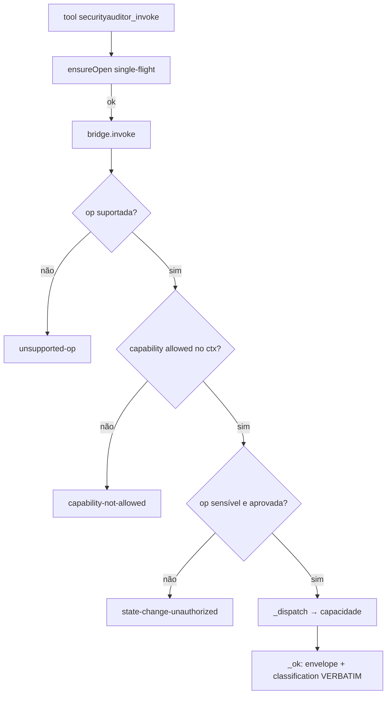

# 3 — Capability Bridge, Pi Adapter e Contratos

## 3.1 Capability Bridge (`tools/web-runtime/bridge.mjs`) ✅ 🧪

**Propósito:** o **ponto único** pelo qual qualquer runtime de agente alcança as capacidades do Web
Runtime, sem reconstruí-las. `createBridge()` → instância de `CapabilityBridge`.

**Superfície estável:**
- `BRIDGE_CAPABILITIES` (7): `capabilities, http, sessions, browser, authorization, concurrent, race`.
- `BRIDGE_OPS` (22) — registro `op → {capability, stateful, sensitive}`. Ops **sensíveis** (exigem
  aprovação do operador): `browser.click`, `browser.fill`, `authorization.run`, `concurrent.run`,
  `race.run` (+ `browser.probe` com método que altera estado, tratado por chamada).

**Métodos principais:**

| Método | Contrato |
|--------|----------|
| `openInvestigation(ctx)` | registra Execution Context TRUSTED; exige `investigationId`, `scope`, `allowedCapabilities` não-vazio; capacidades desconhecidas → `bad-context`; reabertura → `duplicate-investigation` (`bridge.mjs:98`) |
| `invoke({investigationId, op, params, operationId?}, {signal?})` | entrada tipada única; **nunca lança** para falha de domínio — retorna `{ok:false, error:{code,message}}`; `capabilities.*` é discovery sem investigação (`bridge.mjs:146`) |
| `_dispatch(st, op, spec, params, signal)` | roteia a op para a capacidade (`bridge.mjs:200`) |
| `_ok(op, spec, inv, result)` | monta envelope sanitizado e **copia `result.classification` VERBATIM** (`bridge.mjs:181`) — nunca inventa/promove veredito |
| `_approved(ctx, op, url)` | aprovação casa `(a.op==null||a.op===op) && (a.url==null||a.url===url)` (`bridge.mjs:130`) |
| `cancel(investigationId, operationId?)` | aborta uma op ou todas as da investigação (`bridge.mjs:291`) |
| `closeInvestigation(id)` / `shutdown()` | fecha sessões da investigação / libera tudo; sem recuperação entre processos |

**Envelope de resultado:** `{ok, instanceId, investigationId, op, capability, result, classification?}`;
em falha `{ok:false, instanceId, investigationId, op, error:{code, message}}`. Códigos reais incluem
`unsupported-op`, `unknown-investigation`, `capability-not-allowed`, `bad-params`,
`session-not-in-investigation`, `state-change-unauthorized`, `duplicate-investigation`, `race-prerequisites`
(H1e-F1/P2), `no-trusted-context` (adaptador).

**Sanitização** ✅ 🧪 — `sanitizeResult`/`sanitizeMessage` + `evidence.mjs::redactCredentials`: cookies,
tokens, `storageState` nunca saem no envelope (`test-bridge` B11; `test-pi-adapter` P7).



## 3.2 Pi Adapter (`adapters/pi/`) ✅ 🧪 🤖

- **`extension.mjs`** — núcleo **dependency-injected** (`createSecurityAuditorExtension({defineTool, Type,
  bridge, resolveContext})`); importa NADA do Pi (testável no projeto). Registra **2 tools nativas**
  (`TOOL_NAMES`): `securityauditor_capabilities` (op `list`/`probe`) e `securityauditor_invoke`
  (`{investigationId, op, params?, operationId?}`). Honra o `AbortSignal` do Pi.
- **`ensureOpen`** — **single-flight** (H1e-F1/P1): `opened` (Set de sucessos) + `opening` (Map de
  promessas em voo). Uma `openInvestigation` por id sob concorrência; falha é limpa e re-tentável;
  isolamento por id. Testado em `test-convergence.mjs` (P1.0 reproduz a falha original; P1.1–P1.5 provam a
  correção). 🧪
- **`extension-pi.mjs`** — **entry de descoberta** que o operador instala; importa estaticamente
  `@earendil-works/pi-coding-agent` (`defineTool`) + `typebox` (`Type`), cria a Bridge real e o
  `resolveContext` de arquivo. Carregável por `pi -e <path>`. Verificado contra **Pi 1.4.0**.
- **Resultado Pi-nativo:** `toToolResult` → `{content:[{type:"text",…}], details, structuredContent,
  isError}`.

**Trust model:** `resolveContext(investigationId)` lê o Execution Context de um **arquivo escrito pelo
operador** (`SECAUDIT_BRIDGE_CONTEXTS`, JSON chaveado por investigationId) — **nunca do LLM**. Ausente/
inválido → `no-trusted-context` (as tools recusam).

## 3.3 Contratos e schemas

**Execution Context** (operador):
```json
{ "<investigationId>": {
    "scope": { "allowHosts": ["127.0.0.1"], "allowPrivate": true },
    "allowedCapabilities": ["capabilities","sessions","browser","authorization"],
    "limits": { "maxSessions": 6 },
    "approvals": [ { "op": "race.run", "url": "http://127.0.0.1:8731/coupon/redeem" } ] } }
```
- `scope` → Rule 0 + SSRF (cap. 5, `scope.mjs`). `allowedCapabilities` ⊆ `BRIDGE_CAPABILITIES`.
- `approvals` → libera ops sensíveis por `(op,url)`. O agente **não** se autoriza.

**Tool `securityauditor_invoke`** (schema TypeBox): `investigationId:String`, `op:String`,
`params?:Any`, `operationId?:String`. `op` ∈ `BRIDGE_OPS`; `params` são os da op.

## 3.4 Integração de runtimes e MCPs

- **Pi** ✅ 🧪 🤖 — adaptador validado (registro + execução + cancelamento sob o runtime real do Pi;
  `test-pi-adapter.mjs`, `test-pi-entry.mjs`, `test-pi-rpc.mjs`). Contrato de cancelamento RPC real:
  `{type:"abort"}` (confirmado na 1.4.0).
- **Claude Code / Antigravity** 📋 — fundação prevista ([05]/[08]); adaptadores dedicados não implementados.
- **MCPs (GitHub/Confluence/…)** 📋 — ver cap. 7 (H2c/H2d). Não implementados nesta base.
- **Caido** 📋 — arquitetura-alvo em [34] (cap. 7). Não implementado.

## 3.5 Limitações / lacunas
- O schema TypeBox valida forma, não semântica de `params` por op — a validação por op vive na capacidade.
- `operationId` default = `toolCallId` do Pi quando não informado (cancelamento por op requer informá-lo).
