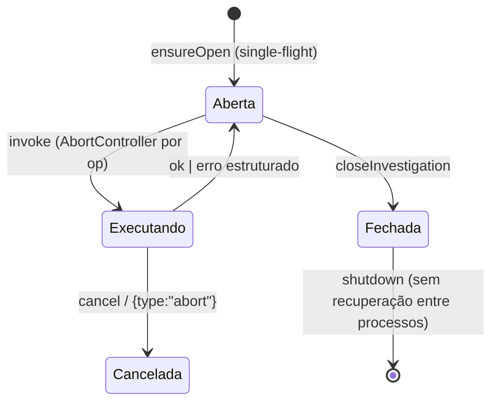

# 5 — Scope Guard, Policies, Evidências, Erros e Cancelamento

## 5.1 Scope Guard (`tools/web-runtime/scope.mjs`) ✅ 🧪

- **Propósito:** impor **Rule 0** (só alvos autorizados) + proteção **SSRF** antes de qualquer requisição.
- **API:** `validateTarget(urlStr, scope)` → lança `ScopeError` se fora de escopo; `_internals` (helpers).
- **Regras:** `scope.allowHosts` (allow-list de hosts); `scope.allowPrivate` libera IPs privados/loopback
  (default: bloquear privados) — base do SSRF guard.
- **Invariante:** alvo fora de escopo **nunca** é tocado (`test-bridge` B4 confirma `evilHits = 0`).
- **Fonte do escopo:** o `scope` vem do **Execution Context** do operador (cap. 3), não do LLM.

## 5.2 Policies imutáveis (`policies/`) ✅

Três policies, **sempre carregadas** (Context Priority), **não modificáveis** nesta e em rodadas de doc:

| Policy | Papel |
|--------|-------|
| `authorization-gate.md` | Action Authorization Gate — autoriza/recusa ações ofensivas (espelhada em `SKILL.md:61`) |
| `verification-contract.md` | contrato de verificação — toda claim precisa de evidência; embutido verbatim em todo brief |
| `native-tooling-doctrine.md` | doutrina de ferramentas nativas no alvo; escalonamento Tier-1 justificado |

> Também existem cópias em `references/` (`authorization-gate.md`, `verification-contract.md`,
> `native-tooling-doctrine.md`) usadas no carregamento; `policies/` é a fonte imutável.

## 5.3 Autorização de execução ✅ 🧪 🤖

- **Execution Context** (operador) é a única fonte de escopo + `allowedCapabilities` + `approvals`.
- **Ops sensíveis** (`browser.click/fill`, `authorization.run`, `concurrent.run`, `race.run`, probe mutante)
  só rodam com aprovação casada por `(op,url)` (`bridge.mjs::_approved`). Sem aprovação →
  `state-change-unauthorized`. **O agente não se autoriza.**
- **Preservação de classificador** ✅ 🧪 — `bridge.mjs::_ok` copia `result.classification` **verbatim** e
  nunca a inventa/promove (`test-convergence` P4.0; `test-bridge` B12). **Ausência de evidência nunca vira
  conformidade.**
- Validação agêntica ([30]): sob falhas e pedidos inválidos o agente **não** ampliou autorização, **não**
  se auto-autorizou, **não** inventou achados — os gates seguraram em todos os turnos.

## 5.4 Evidências e Investigation Records ✅ 🧪 (parcial no fechamento escrito)

- **`evidence.mjs`:** `redactCredentials(text)` (redação), `portableName(url, ext)` (nome portável),
  `record(inspection, ctx)` (registro de evidência). Cookies/tokens/`storageState` nunca persistem em claro.
- **Diretório de evidências = por engagement (pré-piloto):** evidência persistente de auditoria vive em
  **`<engagement>/evidence`**, resolvido do engagement ativo (`selectEngagement().evidenceDir`) — **sem**
  diretório global e **sem** fallback `/tmp`. No Bridge, `browser.screenshot` é roteado para `ctx.evidenceDir`
  e **confinado** por `confineWithin` (symlink-safe); sem engagement ativo → `evidence-no-engagement`;
  escape → `evidence-path-escape`. `/tmp` serve só a arquivos temporários de trabalho (não-auditoria).
  `SA_EVIDENCE_DIR` está **deprecado** (compat só sem engagement; nunca sobrepõe). Detalhes: cap. 16 §16.5.1.
- **Screenshots:** gravados no `dir` da op (confinado ao `evidence/` do engagement); registro inclui hash
  (SHA-256 observado em [30]).
- **Investigation Record** — contrato em `references/flows-agents.md` (**Return contract**), **obrigatório
  (H1e-F1/P4)** para toda investigação com capacidade, mesmo em falha/bloqueio/inconclusivo/orçamento.
  Deve conter: investigationId, techniqueId, hypothesisId, experimentId, capacidade usada, **classificação
  do validador VERBATIM** (ou "none — no validator ran"), sessionIds/resourceIds/requestIds, caminhos de
  evidência, operações executadas, limitações/pendências.
- **Estado real:** emitido completo em A/C ([30]); em B o Record foi **truncado no settle do modelo**
  (🟡 PARTIAL) → **dívida técnica** (persistir o resultado autoritativo independentemente do fechamento
  textual; ver [31]/[32] e cap. 7).

## 5.5 Erros, recuperação e cancelamento ✅ 🧪

- **Modelo de erro:** `bridge.invoke` **nunca lança** para falha de domínio — devolve
  `{ok:false, error:{code, message}}` (`BridgeError`). Mensagens sanitizadas (`sanitizeMessage`).
- **Feedback recuperável (H1e-F1/P2):** erros estruturados orientam recuperação — kinds válidos listados;
  `race-prerequisites` autoexplicativo; códigos distintos para sessão ausente (`bad-params`) × inválida
  (`session-not-in-investigation`) × autorização (`state-change-unauthorized`/`capability-not-allowed`).
- **Cancelamento:** `AbortController` por op combinado ao `signal` do Pi (`bridge.mjs::invoke`);
  `bridge.cancel(inv, operationId?)` aborta uma ou todas. Contrato RPC real do Pi: `{type:"abort"}`.
  Testes: `test-bridge` B8 (cancel in-flight), B9 (timeout), `test-pi-adapter` P6 (AbortSignal).
- **Falha de navegador:** tratada como falha estruturada, sem throw (`test-bridge` B10).
- **Concorrência de abertura:** `ensureOpen` single-flight evita `duplicate-investigation` sob chamadas
  paralelas; falha de init é limpa e re-tentável (`test-convergence` P1.*). 🧪

## 5.5a Fronteiras de contexto e credencial ✅ 🧪

- **Contexto:** nenhuma operação usa outro engagement sem seleção explícita. Sessão presa ao projeto ou à raiz do harness. Em contexto de projeto, `SA_ENGAGEMENT` sem ponteiro igual é recusado, e ponteiro obsoleto também é conflito. No adapter do Pi, contexto com qualquer sinal de engagement (id `eng:`, campo `engagement`, `evidenceDir` sob a raiz, bloco `caido` com `baseUrl`, `token` ou `projectId`) exige seleção correspondente a cada chamada; projeto Caido exige o vínculo do manifesto. Bloco `caido` sem projeto continua utilizável com uma seleção, para `caido.health` e `caido.projects`. Marcador de ativação que seja link é recusado; `deactivate --repair` remove o link sem segui-lo. Na raiz do harness e em diretório comum, um `SA_ENGAGEMENT` exportado ainda seleciona, com aviso.
- **Opt-in do Caido:** decisão em `<harness>/.env.caido-opt-ins.json`, fora do projeto, por caminho real. Conteúdo do projeto não concede o token.
- **Ativação:** recusa o próprio harness como projeto, marcador que seja link e links `.claude`, `.pi` ou `.agents` que saem do projeto; `deactivate` não segue caminhos do marcador para fora dele.
- **Limite:** tudo isso protege contra o conteúdo do projeto e contra erro de operação, **não contra um shell do mesmo usuário**, que lê o `.env` e edita esses arquivos. Isolamento real exige o sistema operacional.

## 5.6 Limitações / lacunas
- Completude do Investigation Record em turnos interrompidos (B) — dívida técnica aberta.
- `evidenceDir` por investigação não auto-derivado do contexto.
- Persistência do veredito autoritativo fora do texto do agente — proposta em [34]/cap. 7 (engagement store).
