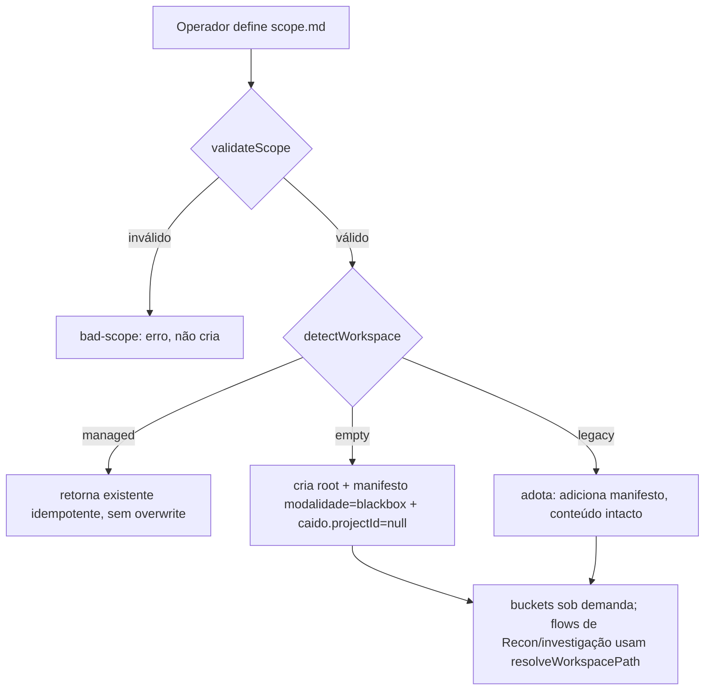

# 8 — Pentest Engagement Workspace (H2c-F1)

> Incremento **H2c-F1**: camada **aditiva e compatível** sobre o workspace `scope.md`/Flow 8. Torna
> **modalidade**, **associação Caido** e **segregação Whitebox** cidadãos de primeira classe, **impostos por
> código** no limite do módulo. Módulo: [`tools/workspace/`](../../tools/workspace/) — **Node puro, zero
> dependências**.

## 8.1 Diagnóstico F0 — o que havia

- O workspace é **100% dirigido por Markdown** (Flow 8 em `references/flows-scope.md` + `references/template-files.md`):
  **não há código** que crie diretórios — o LLM os cria. Engagements vivem em `ENGAGEMENT_ROOTS`
  (**fora do repo do harness** — requisito "independente do código do harness" já atendido por design).
- **Estrutura herdada (bug bounty):** 6 arquivos `cc*.md`, 9 dirs numerados (`1-Reports`…`9-Trashcan`),
  buckets de verdict de report (`Triaged/Accepted/…`), campo `Reportability`. Referenciada por `SKILL.md`
  (Loading Chain/Context Priority) e por `flows-recon/report/status/forge/proxy/agents`.
- **Não havia** `modality` (apenas `Type` livre), **nem** `Whitebox/`, **nem** associação Caido. Código-fonte
  auditado cai hoje em `4-Analysis/` — **não segregado**.
- **Capability Bridge / Web Runtime são path-agnósticos** — independem do workspace (sem risco de regressão).
- **Ponto duro (honesto):** o isolamento Whitebox *efetivo* não pode ser garantido só por Markdown nem só por
  um módulo Node, porque agentes usam `read`/`bash` crus que ignoram qualquer módulo (ver §8.6).

## 8.2 Arquitetura implementada (F1)

| Arquivo | Papel |
|---------|-------|
| `tools/workspace/engagement.mjs` | manifesto, modalidade, associação Caido, resolver confinado, gate Whitebox, auditoria |
| `tools/workspace/whitebox-guard.mjs` | `decideWhiteboxAccess()` — **ponto de decisão puro e testável** (o mecanismo real) |
| `tools/workspace/whitebox-guard-hook.mjs` | **PreToolUse hook de referência** (Claude Code) — não auto-instalado |
| `tools/workspace/test-engagement.mjs` | **16 testes** determinísticos/offline |

**Manifesto** `.engagement.json` (adicionado ao root do engagement, **nunca sobrescreve** arquivos):
```json
{ "schema": 1, "name": "Acme Web", "modality": "blackbox",
  "created": "2026-11-05T...", "caido": { "projectId": null },
  "whitebox": { "reserved": true, "authorized": false, "grants": [] } }
```
- `WORKSPACE_SCHEMA = 1`; `detectWorkspace` → `managed` | `legacy` | `empty` (**sem migração** de legados;
  um legado é *adotado* só ganhando o manifesto, conteúdo intacto).
- `BUCKETS` preserva os 9 dirs **verbatim**; **criação preguiçosa** (`ensureBucket`) — **sem dirs vazios no init**.

## 8.3 Fluxo de inicialização (preserva `scope.md`)


`initEngagement({root,name,modality?,caidoProjectId?,scope?})` → descritor. Associação Caido futura =
campo `caido.projectId` (default `null`; **nada de Caido implementado** nesta rodada).

## 8.4 Modalidades

`MODALITIES = blackbox (default) | graybox | whitebox`. A modalidade **influencia a disponibilidade de
fontes/capacidades** sem criar três sistemas (`sourcesForModality`):

| Modalidade | web (http/browser) | credentials | code / whitebox |
|-----------|--------------------|-------------|------------------|
| blackbox  | ✅ | ❌ | ❌ |
| graybox   | ✅ | ✅ | ❌ (agnóstico a código por padrão) |
| whitebox  | ✅ | ✅ | ✅ **somente com autorização explícita** (duplo gate) |

Black/Gray Box permanecem **agnósticos ao código**. Modalidade `whitebox` **sozinha não concede** acesso —
exige `authorizeWhitebox({operator,reason})`. Ter um repositório disponível **não** infere acesso.

## 8.5 Isolamento Whitebox — o que é imposto por código

`decideWhiteboxAccess` (usado por `resolveWorkspacePath` e pelo hook) nega por padrão qualquer caminho sob
`Whitebox/` a menos que `modality==="whitebox"` **E** `whitebox.authorized===true`; também rejeita travessia/
caminhos absolutos (integridade de path). Toda tentativa/elevação é **auditada** em `.whitebox-access.log`
(append-only) + `grants[]` no manifesto. `composeContextPaths()` (composição "normal" de contexto) **sempre
exclui** `Whitebox/`. `revokeWhitebox()` nega novamente e **sinaliza `requiresCleanContext:true`**.

| Requisito §6 | Imposto nesta rodada |
|---|---|
| 1 Dispatcher não inclui Whitebox na composição normal | ✅ `composeContextPaths` exclui `Whitebox/` |
| 2–3 Agentes/buscas não consomem Whitebox sem autorização | 🟡 **via módulo/hook** — ver limitação §8.6 |
| 4 Guidelines Black Box não usam hipóteses Whitebox | 🟡 segregação + default-deny (não há conector nesta rodada) |
| 5 Acesso exige ação explícita do operador | ✅ `authorizeWhitebox` exige `operator` |
| 6 Elevação rastreável | ✅ auditoria + `grants[]` |
| 7 Retorno a Black Box exige contexto limpo | 🟡 `requiresCleanContext` **sinalizado** (o módulo não purga contexto do LLM) |

## 8.6 Limitação central (declarada, não mascarada)

O gate de código governa **acesso que passa pelo módulo** (`resolveWorkspacePath`) ou por um wrapper de
camada-de-ferramentas que o consulte. **Não** impede, sozinho, um `bash cat Whitebox/...` ou `read` cru
emitido por um agente que nunca chama o módulo. Isolamento *efetivo* de camada-de-ferramentas exige um
**controle por runtime**: para Claude Code, o `whitebox-guard-hook.mjs` (PreToolUse, **não auto-instalado** —
arme via `.claude/settings.json`); Pi/Antigravity precisam de equivalentes **ainda inexistentes**.
**Não afirmamos** que o controle de camada-de-ferramentas está implementado/universal — é **PLANNED**
(H2c-F2+/H2d Preflight). Instruções de prompt **não** são consideradas isolamento suficiente.

## 8.7 Compatibilidade e antes/depois

| Aspecto | Antes | Depois |
|---|-------|--------|
| Criação do workspace | Markdown/Flow 8 (LLM) | **inalterado** + manifesto aditivo opcional |
| `scope.md` | fonte do escopo | **preservado** (`validateScope` adiciona checagem, não substitui) |
| 9 dirs / cc files | criados no init | **preservados**; criação agora preguiçosa no módulo |
| Modalidade | `Type` livre | `modality` tipada (default blackbox) |
| Código auditado | `4-Analysis/` (não segregado) | `Whitebox/` reservado + gate de código |
| Caido | — | campo `caido.projectId` reservado (null) — **pré-piloto:** binding/seleção por engagement, ver cap. 16 |
| Engagements antigos | — | **adotados sem migração**; `kind:"legacy"` reconhecido |

**Preservados/intactos:** 127 corpos (Validador 127/127), `agents/` (17), `policies/` (3), dispatcher/
roteamento, Flows de Recon, Flows 9/12, Capability Bridge, Pi Adapter, HTTP/Browser, Authorization Matrix,
Race Validator, Investigation Records, workspaces existentes. **Nenhum conversor de migração** criado.

## 8.8 Testes (16/16) e uso

`node tools/workspace/test-engagement.mjs` → **16/16**. Cobre: novo engagement · legado/existente · scope
válido/ inválido · isolamento entre engagements · associação de artefatos · integridade de path · Recon na
nova estrutura · Investigation Record · compatibilidade de relatórios · Black Box default · **ausência de
leitura automática de Whitebox** (gate real) · enum de modalidade. Os testes de isolamento verificam o
**mecanismo de código** (`resolveWorkspacePath`/`decideWhiteboxAccess`), não a redação de prompts. Regressões
`web-runtime` (bridge 15, convergence 11, investigation 13, sessions 15, authz 18, concurrent 18, race 20) e
Validador **127/127** verdes.

```js
import { initEngagement, resolveWorkspacePath, authorizeWhitebox } from "./tools/workspace/engagement.mjs";
const e = initEngagement({ root: process.env.ENGAGEMENT_ROOT, name: "Acme Web", scope: scopeText });
const reconDir = resolveWorkspacePath(e, "3-Recon/host-enum.md");      // ok (blackbox)
// resolveWorkspacePath(e, "Whitebox/src/app.js")                       // throws WhiteboxAccessError
```

## 8.9 Dívidas / lacunas

- **Isolamento de camada-de-ferramentas não universal** (§8.6) — PLANNED (hook de referência existe só p/
  Claude Code; demais runtimes pendentes).
- Integração do módulo aos Flows (Flow 8 chamar `initEngagement`) é **opcional/aditiva** e não foi forçada no
  dispatcher nesta rodada (ver `references/flows-scope.md`, nota aditiva).
- Conectores Whitebox (GitHub/Confluence/code review/secret scan/STRIDE/Business Logic) → **H2c-F2+**.
