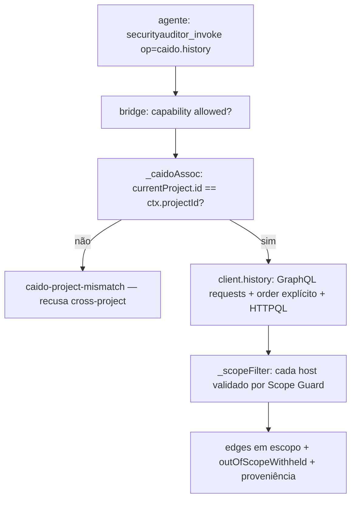

# 9 — Caido Connectivity & HTTP Intelligence (H2b-F1)

> Incremento **H2b-F1**: adaptador Caido **read-only** acessível pelo mecanismo existente do SYNAPSE
> (Capability Bridge + Execution Context + Pi Adapter + Scope Guard). Implementa a arquitetura **"B-enxuta"**
> aprovada em [`../architecture-review/34-h2b-f0-caido-integration-assessment.md`](../architecture-review/34-h2b-f0-caido-integration-assessment.md):
> Node + `fetch` nativo ↔ GraphQL do Caido, **zero dependências novas**. **Não** implementa monitoramento
> contínuo, operações ativas, Replay, Findings nem workflows (→ H2b-F2+).

## 9.1 Arquivos e integração

| Arquivo | Papel | Status |
|---------|-------|--------|
| `tools/web-runtime/backends/caido.mjs` | cliente GraphQL read-only (`createCaidoClient`) | ✅ 🧪 |
| `tools/web-runtime/capability.mjs` | expõe `caido.client` (mesmo padrão de `http`/`sessions`/…) | ✅ |
| `tools/web-runtime/bridge.mjs` | capability `caido` + 4 ops + associação/escopo/proveniência | ✅ 🧪 |
| `tools/web-runtime/test-caido.mjs` | **19 testes** determinísticos/offline (mock GraphQL) | 🧪 |

Integração **aditiva** — **não** há segundo dispatcher nem camada paralela de agentes. O agente alcança o
Caido pela tool `securityauditor_invoke` já existente do Pi Adapter (`op: "caido.*"`). Decisão registrada:
adicionar a capability é o **padrão aditivo** das demais (não é modificação significativa do Bridge nem do
modelo de engagement), logo a implementação prosseguiu sem bloqueio arquitetural.

## 9.2 Contratos GraphQL (nomes REAIS do SDL verificado)

Fonte: `caido/schemas` → `schemas/proxy/schema.graphql` (SDL vivo, HTTP 200, 122 KB). **Nada inventado.**
Root é `QueryRoot` (não `Query`). Operações read-only usadas:

| Finalidade | Operação GraphQL (verificada) |
|-----------|-------------------------------|
| Health / projeto atual | `currentProject { project { id name version readOnly } readOnly }` (+ `runtime { __typename }`) |
| Projetos acessíveis | `projects { id name path readOnly status temporary version … }` **`@cloud`** (degrada local) |
| HTTP History | `requests(first,after,filter:HTTPQLInput,order:RequestResponseOrderInput,scopeId:ID): RequestConnection!` |
| Request por id | `request(id: ID!): Request` |

- **Filtro HTTPQL:** `filter: { code: "<HTTPQL>" }` (`input HTTPQLInput { code: String! }`).
- **Ordenação (sempre explícita):** `order: { by: CREATED_AT, ordering: ASC }` — enums `RequestResponseOrderBy`
  / `Ordering`. **Nunca** presumimos ordem não documentada.
- **Paginação por cursor:** `RequestConnection.edges[].cursor` + `pageInfo { endCursor hasNextPage
  startCursor hasPreviousPage }`.
- **`Request.response: Response`** é **anulável** → request sem response é representado como
  `responseAvailable:false, response:null`.
- **Auth:** header `Authorization: Bearer <token>` (PAT prefixo `caido_` ou access token). ⚠️ o SDL não expõe
  query de versão dedicada; usa-se `Project.version` como sinal (limitação §9.7).

**Ops expostas na Bridge** (todas `caido`, `stateful:false`, `sensitive:false` — read-only, sem aprovação):
`caido.health` · `caido.projects` · `caido.history` · `caido.request`.

## 9.3 Configuração segura (Execution Context)

O operador — **nunca o LLM** — provê a config no Execution Context (mesmo mecanismo da Bridge):
```json
{ "ENG-1": {
    "scope": { "allowHosts": ["app.lab","127.0.0.1"], "allowPrivate": true },
    "allowedCapabilities": ["caido"],
    "caido": { "baseUrl": "http://127.0.0.1:8080", "token": "<PAT/accessToken>", "projectId": "proj-1", "scopeId": null } } }
```
- **PAT nunca** é persistido no `.engagement.json` (manifesto H2c tem só `caido.projectId`), **nunca** em logs,
  exceptions ou Investigation Records — redigido em toda saída (`sanitizeMessage`/`redactCredentials`).
- `caido` em `allowedCapabilities` sem bloco `caido` → `caido-not-configured` (falha segura).

## 9.4 Fluxo (associação, escopo, proveniência)


Cada registro retornado carrega **proveniência estruturada**: `provenance { source:"caido", engagementId,
caidoProjectId, caidoRequestId, caidoResponseId|null, responseAvailable, ts }` + `resource { host, method,
url, statusCode }` + `record` (dados de tráfego **inertes**). Preserva o vínculo com o registro original;
**não** copia grandes volumes (page-size limitado, raw só sob `detail` e com cap/redacção).

## 9.5 Segurança e isolamento (garantias impostas)

| Garantia | Mecanismo |
|----------|-----------|
| Associação explícita projeto↔engagement | `_caidoAssoc` exige `currentProject.id === ctx.caido.projectId`, senão recusa |
| Sem acesso cross-project / cross-engagement | mesmo gate — projeto diferente → `caido-project-mismatch`, zero dados |
| Escopo avaliado antes de expor tráfego | `_scopeFilter`/`validateTarget` por host (Rule 0); `caido.request` fora de escopo → `out-of-scope` |
| Cookies/tokens/headers sensíveis | `redactRaw` (linhas `Cookie`/`Set-Cookie`/`Authorization`/…) + `redactCredentials`; PAT nunca exibido |
| Limites de tamanho | `maxResponseBytes` (payload GraphQL), `maxRawBytes` (blob), `maxPageSize` (clamp de `first`) |
| Timeout / cancelamento | `AbortController` + timeout; `signal` do Pi combinado → `caido-timeout` / `caido-cancelled` |
| Falha de auth / config inválida | `caido-auth-failed` (401/403) · `caido-not-configured` · `caido-bad-config` |
| **Somente leitura** | `assertReadOnly` recusa qualquer doc com `mutation`/`subscription`; 0 writes (testado) |
| Tráfego ≠ instrução | todo `record.untrusted = true`; conteúdo confinado a campo de dados, nunca interpretado |

## 9.6 Testes (19/19) e validação real

`node tools/web-runtime/test-caido.mjs` → **19/19**. Cobre os 18 cenários do brief + read-only:
conexão válida · indisponível · falha de auth · projeto inexistente · projeto diferente do engagement ·
HTTPQL válido/inválido · paginação/cursores · request sem response · registro fora de escopo · redação de
segredos · resposta excessiva · timeout/cancelamento · ausência de config · isolamento entre engagements ·
registro aditivo da capability · proveniência · **rejeição de tráfego como instrução**. Regressões: Bridge
**15/15**, demais suites e Validador **127/127** verdes.

> **Validação com Caido real (Omarchy, H2d-F2): PARCIAL.** Descoberta read-only **comprovada ao vivo** na
> instância local — endpoint, autenticação (Bearer) e `caido.projects` (11 projetos) PASS; `history`/`request`
> permanecem **NOT RUN** (gated por associação projeto↔engagement + scope). Relatório de evidências:
> [`../architecture-review/37-h2d-f2-omarchy-caido-validation.md`](../architecture-review/37-h2d-f2-omarchy-caido-validation.md).
> **Mocks não substituem** a validação conectada das demais ops. Smoke test read-only (sem LLM):
> ```bash
> # Execution Context com caido.baseUrl/token/projectId provisionado pelo operador
> node -e 'import("./tools/web-runtime/capability.mjs").then(async m=>{const c=m.caido.client({baseUrl:process.env.CAIDO_URL,token:process.env.CAIDO_PAT});console.log(await c.health());console.log((await c.history({first:3})).edges.map(e=>e.record.url));})'
> ```
> Cobrindo: conexão · projeto selecionado · consulta HTTPQL · recuperação request/response. **Não** instalar
> nem reconfigurar Caido automaticamente.

## 9.7 Limitações / dívidas

- **Integração real NOT RUN** (sem instância autorizada) — ver §9.6.
- **Sem query de versão/capabilities dedicada** no SDL → usa-se `Project.version`/`runtime.__typename` como
  sinal de responsividade; identificação fina de versão é limitada.
- **PAT→accessToken:** o Caido pode exigir troca via Device Authorization flow; o adaptador aceita um bearer
  pronto — o operador fornece um token válido (a troca não é automatizada nesta rodada).
- **`projects` é `@cloud`** — em instância local pode indisponibilizar; `listProjects` degrada para
  `currentProject`.
- **Estabilidade do schema** varia entre releases do Caido (fixar versão no teste de aceitação real).
- **Sem monitoramento contínuo / cursor persistente** → **H2b-F2** (§9.8).

## 9.8 H2b-F2 — Live History Monitoring (✅ implementado — ver cap. 10)

> **Implementado** em [`10-caido-live-history-monitor.md`](10-caido-live-history-monitor.md)
> (`tools/web-runtime/caido-monitor.mjs`, 24/24 testes). Contratos de origem (abaixo) honrados lá.

Contratos do próximo incremento: descobrir novos requests e a chegada
**posterior** das responses por **poll de cursor** (`requests(order:{by:CREATED_AT,ordering:ASC}, after:
<endCursor>)`), persistir checkpoint `{caidoProjectId, endCursor, ts}` por engagement, reconciliar perdidos
(backfill `created_at > lastCursor`), deduplicar por `caidoRequestId`, controlar backlog e recuperar
reconexão — **sem chamadas LLM por request** (triagem por heurística/HTTPQL). A `pageInfo.endCursor` já
exposta por `caido.history` é o ponto de partida.

## 9.9 Necessidades futuras para H2d/Preflight (registro)

O Preflight (H2d, 📋) deverá diagnosticar, **sem LLM e sem operação ofensiva**: endpoint Caido acessível ·
autenticação (token válido) · projeto autorizado existe e é o `currentProject` · permissões read-only ·
compatibilidade de schema/versão da API · capacidade de consulta ao History (query `requests` mínima). O
perfil `caido-native` depende desses checks; sua ausência → `DEGRADED`/`BLOCKED` conforme o perfil.
