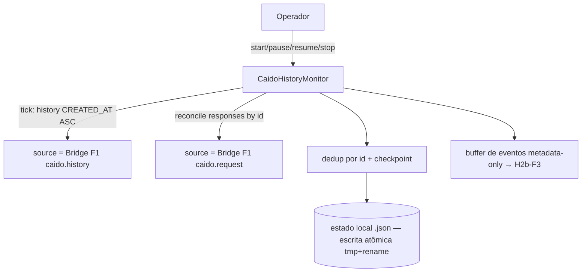

# 10 — Caido Live History Monitor (H2b-F2)

> Incremento **H2b-F2**: monitor **incremental e determinístico** do HTTP History do projeto Caido
> associado ao engagement, enquanto o operador pentesta manualmente. **Sem** raciocínio agêntico contínuo,
> Replay, Findings ou Workflow Intelligence (→ H2b-F3+). Node stdlib, **zero dependências**, **sem** DB,
> **sem** scheduler genérico, **sem** serviço adicional. Módulo: `tools/web-runtime/caido-monitor.mjs`.

## 10.1 Diagnóstico — semântica real de paginação (§1)

Confirmado contra o SDL verificado em [cap. 9](09-caido-connectivity.md):

| Questão | Achado | Consequência de projeto |
|---------|--------|--------------------------|
| Ordenação | `order: { by: CREATED_AT, ordering: ASC }` (enum real) | ordem **explícita** sempre; nunca assumida |
| `endCursor`/`after` | cursor **opaco**; `RequestConnection` expõe `snapshot: Snapshot!` → avaliado contra snapshot | **não** tratar cursor como log de eventos |
| Novos requests | aparecem no fim (maior `createdAt`) | fast-path `after:cursor` os captura |
| Atualização de requests | `Request.edits[]` existe; **sem feed de mudanças** | edições arbitrárias **não** rastreadas (limitação) |
| Chegada posterior de response | `Request.response` anulável | **reconciliação por id** (re-leitura dirigida) |
| Paginação inconsistente em inserções | possível (dataset mutável) | **dedup por id** + passe periódico de **reconciliação por janela** |
| Reconciliação pós-desconexão | sem cursor confiável como log | re-scan desde o início/janela, idempotente por id |

**Conclusão (honesta):** a API **não** oferece um feed de eventos/atualizações confiável. O menor mecanismo
compatível adotado: **CREATED_AT ASC + dedup por `id` estável + reconciliação explícita de responses por id +
passe periódico de reconciliação**. Limitações documentadas em §10.6.

## 10.2 Arquitetura

Reutiliza o **caminho F1 da Bridge** via um `source` injetado (`createBridgeSource({bridge, investigationId})`
→ `caido.history`/`caido.request`). Assim, **associação projeto↔engagement, proveniência e redação de F1 valem
automaticamente** — o monitor não os reimplementa. **Nota (leitura desacoplada do scope):** desde
[42](../architecture-review/42-caido-readonly-scope-decouple.md), a leitura read-only do History **não** retém
registros fora de escopo — todos são retornados **anotados** `inScope` (a distinção in/out é preservada). O Scope
Guard continua **hard-enforced para operações ATIVAS** (Replay/Findings). O monitor recebe todos os registros
anotados; cabe ao consumidor filtrar por `inScope` se desejar.



## 10.3 Ciclo `tick()` (unidade determinística)

1. Só roda em `RUNNING`. Cada N ciclos faz **reconcile** (re-scan desde o início) além do fast-path.
2. **Poll:** páginas `history(first, after, CREATED_AT, ASC)` até `maxPagesPerCycle`; novo ⇔ `id ∉ seenIds`
   → emite evento `new`, incrementa `processedCount`; sem response → entra em `awaiting`. Avança `cursor`
   (fast-path) e `lastCreatedAt`.
3. **Reconciliação de responses:** re-lê por id um lote limitado de `awaiting` (`caido.request`); response
   presente → evento `updated`, remove de `awaiting`.
4. `backlog = count − processedCount`; `connection = up`; `lastSyncAt`; **persiste** (atômico).
5. Falha: transitória → **backoff exponencial limitado** + retry (até `maxRetries`, senão `ERROR`);
   permanente (`caido-project-mismatch|not-configured|auth-failed|bad-config|out-of-scope`) → `ERROR` sem
   retry; `cancelled` → sem mudança de estado.

## 10.4 Persistência e estados (§3)

Estado local JSON (um por engagement/projeto), **escrita atômica** (`tmp` + `rename`), `schema` versionado:
```json
{ "schema":1, "engagementId":"ENG-1", "caidoProjectId":"proj-1", "state":"RUNNING",
  "checkpoint": { "cursor":"…", "lastCreatedAt":"…", "processedCount":123 },
  "seenIds":["req-1", "…(limitado a maxSeenIds)"],
  "awaitingResponse": { "req-9": { "firstSeenAt":"…", "cycles":2 } },
  "lastReconcileAt":"…", "failures":["…(limitado)"], "stats":{ "new":120, "updated":44 } }
```
- **`load()` nunca auto-resume:** um estado `RUNNING` volta como `PAUSED` (reinício é decisão explícita).
- Estado de **outro** engagement/projeto → `state-mismatch` (isolamento). Arquivo corrompido → ignorado com
  aviso em `pending` (sem perda silenciosa de dados válidos).
- **Só metadados/refs** persistidos; **nunca** conteúdo completo de tráfego nem PAT/credenciais.

## 10.5 Segurança (§4) e observabilidade (§8)

| Garantia | Como |
|----------|------|
| Só projeto autorizado / sem cross-project | herdado de F1 (`_caidoAssoc`); estado é por engagement+projeto |
| Scope Guard / sem tráfego fora de escopo | herdado de F1 (`_scopeFilter`); o monitor só vê edges já filtrados |
| Sem PAT/credenciais persistidos | eventos/estado são metadata-only; redação de F1 |
| Tráfego = dado não confiável | eventos carregam só `{host,method,url,statusCode,ids,ts}` — nunca `raw`/corpo; presença de registro **não** autoriza teste ativo |
| Sem escrita no Caido / sem Replay/Findings | source só chama `caido.history`/`caido.request` (query-only); nenhuma superfície de escrita |
| Sem Whitebox | o monitor não acessa `Whitebox/` |
| Limites/memória | `maxSeenIds`, `maxAwaiting`, `maxEvents`, `maxPagesPerCycle`; overflow **registrado** em `pending` (sem perda silenciosa) |
| Timeout/cancelamento/shutdown | `AbortSignal` por tick; `stop()`/`shutdown()` limpam timer e persistem |
| Sem LLM por request | `tick()` é puro I/O sobre o `source`; nenhuma chamada LLM |

**`status()`** (consumível por Preflight H2d e Copilot H2b-F3): `state` (IDLE/RUNNING/PAUSED/STOPPED/ERROR) ·
`connection` · engagement/projeto · `lastSyncAt`/`lastReconcileAt` · `new`/`updated` · `pendingResponses` ·
`backlog` · `processedCount` · `failures`/`lastFailure` · `eventsBuffered`/`eventsDropped` · `checkpoint`.
**Interface de leitura p/ F3:** `drainEvents(max)` / `peekEvents()` (eventos metadata-only).

## 10.6 Limitações / dívidas (§11)

- **Sem feed de mudanças do Caido:** edições arbitrárias de requests já vistos **não** são rastreadas (só a
  chegada de response, via reconciliação por id). Documentado.
- **Cursor opaco / snapshot:** o fast-path `after:cursor` pode perder inserções **fora de ordem**; mitigado
  pelo passe de reconciliação periódico (`reconcileEveryCycles`) — trade-off custo×completude configurável.
- **Formato de `created_at` em HTTPQL não verificado** → o incremental **não** usa filtro HTTPQL de data;
  usa cursor + dedup + reconciliação. Filtro por `created_at` fica como otimização futura (verificar formato
  em instância viva).
- **Integração real: `NOT RUN`** (sem instância de laboratório autorizada) — ver §10.7.
- Eviction de `seenIds`/overflow de `awaiting` são **registrados** (não silenciosos), mas impõem janela
  finita de dedup — adequada a History append-mostly; documentado.

## 10.7 Validação de compatibilidade (§7) — `NOT RUN`

Sem instância de laboratório autorizada; **mocks não são comprovação operacional**. Smoke test read-only
(sem LLM) para quando houver instância autorizada:
```js
import { createBridge } from "./tools/web-runtime/bridge.mjs";
import { createBridgeSource, createCaidoHistoryMonitor } from "./tools/web-runtime/caido-monitor.mjs";
// bridge.openInvestigation({... caido:{baseUrl,token,projectId} ...}) provisionado pelo operador
const source = createBridgeSource({ bridge, investigationId: "ENG-1" });
const mon = createCaidoHistoryMonitor({ engagementId: "ENG-1", caidoProjectId: "proj-1", source, statePath: "./.state/ENG-1.monitor.json" });
await mon.start({ intervalMs: 5000 });   // conexão · projeto · history · paginação · polling
// faça 1 request manual no Caido → próximo tick deve detectar "new"; ao chegar a response → "updated"
console.log(mon.status());
```
**Não** instalar/reconfigurar Caido nem criar requests contra alvos externos.

## 10.8 Critérios para H2b-F3 (Copilot consumption)

F3 consumirá, **sem** implementar agora: `drainEvents()` (fluxo metadata-only já sincronizado) + `status()`;
correlação de cada evento com técnicas T[N]/B[N] + hipótese + Investigation Record; recomendações copilot
**sem** interromper o operador e **sem** iniciar testes ativos automaticamente. O contrato de evento
(proveniência + recurso) e o `status()` já estão estáveis para esse consumo.
